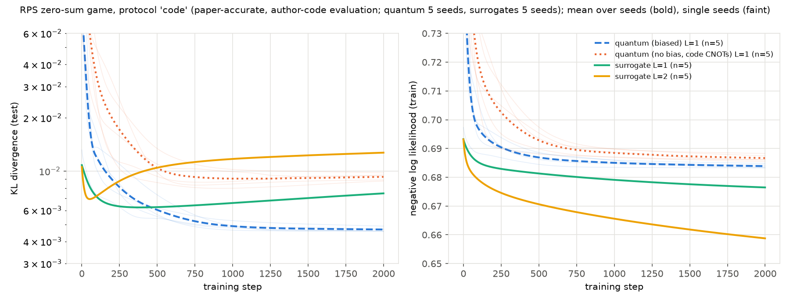
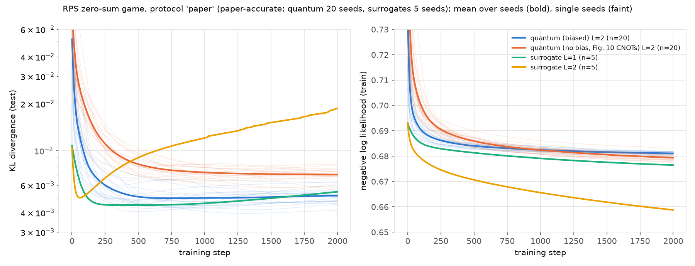
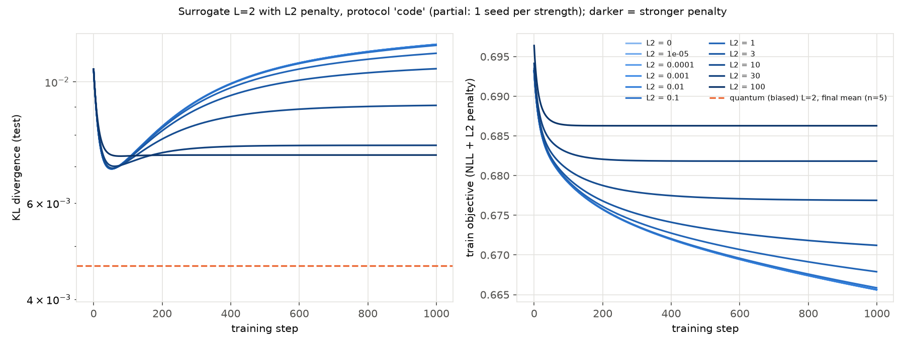
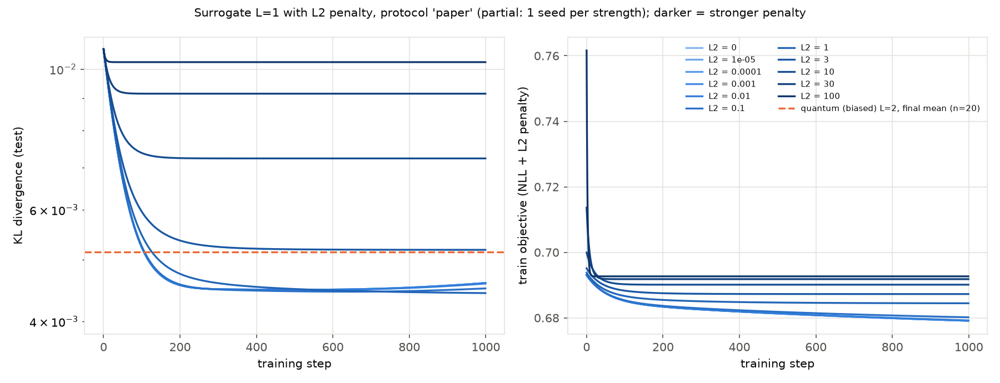
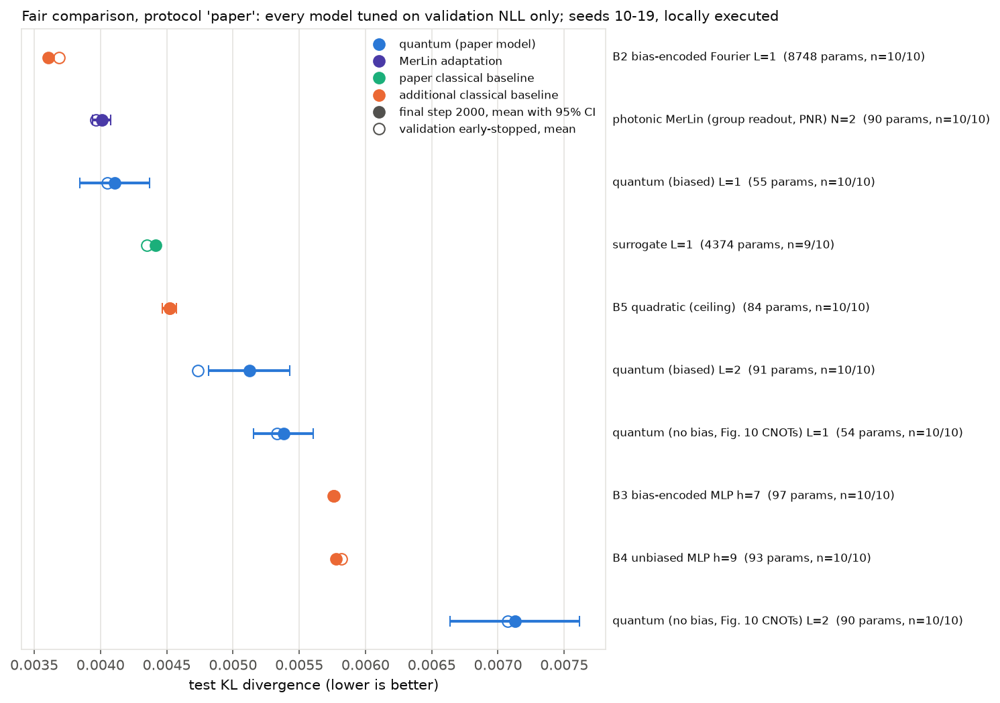
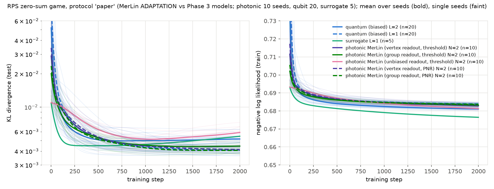

# Contextuality and Inductive Bias in Quantum Machine Learning — Reproduction

> Status: complete, with documented partial items.
> - The Fig. 8, 9 and 11 experiments and the theory checks are reproduced.
> - A MerLin photonic adaptation is implemented and evaluated (status
>   `MERLIN_IMPLEMENTATION`).
> - A fair comparison with equally tuned, capacity-matched classical
>   baselines finds that a classical model encoding the same zero-sum bias
>   generalises best. The paper's reading that the biased quantum model
>   beats the classical alternatives is therefore not supported.
>
> Working notes, inventories and every decision live in `LOG.md`; durable
> lessons are in `INSIGHTS.md`.

## Reference and Attribution

- Paper: Contextuality and inductive bias in quantum machine learning (arXiv
  preprint, quant-ph, 2023; v1 2 Feb 2023, v3 18 Apr 2023)
- Authors: Joseph Bowles, Victoria J. Wright, Máté Farkas, Nathan Killoran,
  Maria Schuld
- DOI/arXiv: [arXiv:2302.01365](https://arxiv.org/abs/2302.01365)
  (DOI 10.48550/arXiv.2302.01365); PDF: https://arxiv.org/pdf/2302.01365
- Original repository: [XanaduAI/Contextual-ML](https://github.com/XanaduAI/Contextual-ML), linked from the
  arXiv page. It contains `numerics.ipynb` (PennyLane + JAX + Optax), which
  generates the Section 8 "outperforming classical surrogates" plots, and the
  data files `Xdata.npy` / `Ydata.npy`. GitHub shows no license for it, so its
  code is not copied here without clarifying terms.
- License and attribution notes: the arXiv paper is distributed under CC BY
  4.0. This reproduction is an independent reimplementation; cite the original
  paper (see below) when using these results.

## Original Paper

The paper asks which data structures suit quantum models and uses Spekkens'
generalised contextuality to answer it. A trained multi-task model defines an
operational scenario (preparations: inputting x; effects: reading label y of
task k). The model is contextual when its statistics have no noncontextual
ontological model (Def. 3.2).

For m = 3 binary tasks with the zero-sum constraint
E[Y1|x] + E[Y2|x] + E[Y3|x] = 0, the constraint is an operational equivalence
between effects. Any noncontextual model that encodes it satisfies
P(E1+|s1) + P(E2+|s3) + P(E3+|s5) <= 5/2 (Lemma 4.1). Its behaviour hull
therefore cannot contain the inner hexagon V_{2/3} (Theorem 4.1), which is a
limit on expressivity.

A three-player rock-paper-scissors (RPS) game with zero-sum payoffs (Sec. 5)
instantiates the bias. The paper then builds quantum models that encode it
(Sec. 7):
- a state-based 3-qubit ansatz whose generators commute with H = Z1+Z2+Z3
  (Fig. 7);
- trine observables and a new even-dimension construction (App. D).

Sec. 8 trains the biased model on 1500 RPS samples. It reports a lower test KL
divergence (Eqs. (102)-(103)) than a generic 3-qubit model (Fig. 10) and two
linear Fourier-feature "classical surrogates" with L = 1, 2 (Fig. 8). L2
regularisation does not close the gap (Figs. 9, 11). The authors attribute
the gap to the inductive bias and state that it is not evidence of quantum
advantage.

## Reproduction Scope, Claims, and Deviations

What is reproduced, with experiment IDs from `LOG.md`:

| ID | Paper item | What we run |
|---|---|---|
| E1 | Fig. 8 | Biased and generic quantum models (L = 1, 2; B = 2), surrogates L = 1, 2; 2000 full-batch steps, multiple seeds |
| E2, E3 | Figs. 9, 11 | Surrogate L = 2 / L = 1 with an L2-strength grid, 1000 steps |
| E4 | Sec. 5 | Game rules, zero-sum bias, extremal strategies (tests) |
| E5 | Lemma 4.1, Theorem 4.1 | Linear programs: bound 5/2, eta threshold |
| E6-E8 | Sec. 7-8 | Bias invariance, App. D observables, Fourier spectrum (tests) |
| X3 | Fig. 8 claims (Phase 5) | Fair comparison: every model tuned on a validation split, 10 final seeds, classical baselines B2-B5 with and without the bias |
| X1, X2 | extensions (Phase 5) | Contextuality witness of the trained models; test KL by distance from the centre of the behaviour space |

Claims tested (full inventory with confounders in `LOG.md`, "Claim Inventory"):

| ID | Claim | Outcome |
|---|---|---|
| C1, C2 | A noncontextual model encoding the zero-sum bias obeys the Lemma 4.1 bound 5/2, so it cannot contain V_{2/3} (Theorem 4.1) | supported, exact |
| C3 | The RPS data obey the bias; six deterministic strategies give the extremal behaviours | supported (tests) |
| C4, C5 | The Fig. 7 ansatz and the trine / App. D observables encode the bias | supported (tests, < 1e-12) |
| C6 | Quantum outputs are Fourier series with spectrum Omega_L (surrogate class contains them) | supported (exact fit) |
| C7 | The biased quantum model (L = 2) reaches the lowest test KL | reproduced numerically under the author-code evaluation; **unsupported** under the fair comparison |
| C8 | Surrogates beat the generic quantum model | partially supported (L = 1 only) |
| C9 | Surrogates overfit | supported |
| C10 | L2 regularisation does not bring the surrogates to the biased level | **unsupported** under the fair comparison |
| C11 | The gap is due to the zero-sum bias, which "cannot be easily encoded" classically | partially supported: the bias helps, but a classical model encodes it exactly and wins; contextuality is not needed |

Updates and deviations:

- **PyTorch reimplementation**, not the authors' JAX/PennyLane notebook. The
  author repository has no license, so its code is not copied. The simulator
  matches PennyLane to 1e-12, and torch Adam/SGD match optax to 1e-12 (tests).
- **Three test-scaling protocols**, selected with `--protocol`. The author
  code scales training inputs by pi/2 but evaluates the test KL on unscaled
  inputs (discrepancy D12 in `LOG.md`; also found by a third-party fork).
  - `paper` (default): pi/2 on both. This matches the paper text and is used
    for the verdict.
  - `code`: reproduces the published curves.
  - `fork`: unscaled on both.
- **Generic model entangler.** Fig. 10 (CNOT 1->2, 2->3, 1->3) is the
  default. `--cnot-pattern code` reproduces the author code, which applies
  CNOT(1->2) three times (D3).
- **One fixed seeded test set** (10000 strategies, seed 2302) shared by every
  run, instead of a fresh draw per run (D8).
- **Factorised surrogate evaluation**: the same function and gradients as
  the dense features, with 0.64 GB peak memory instead of 2.5 GB for L = 2.
- **L2 strengths for Figs. 9 and 11** are not given. A grid is pre-declared
  in `LOG.md`.
- **Fair comparison (Phase 5, not in the paper).**
  - Every model is trained with Adam for 2000 steps.
  - Hyperparameters are selected on a held-out validation split (data seed
    201) by final validation NLL, never on the test set.
  - Additional baselines: B2 (the paper's L = 1 surrogate with a softmax over
    the six hexagon vertices, so the zero-sum bias is exact), B3 and B4 (MLPs
    with and without the bias, about 91 parameters) and B5 (a degree-2
    polynomial, a ceiling whose class contains the truth).

## Project Layout

```text
lib/rps_game.py        payoff rules of Sec. 5, hexagon vertices
lib/data.py            author data loader (SHA-256 checked), App. F generator, Eq. (93) features, protocols, build_dataloader
lib/simulator.py       batched float64 3-qubit statevector (PennyLane gate conventions)
lib/quantum_models.py  biased model (Fig. 7) and generic model (Fig. 10)
lib/surrogate.py       Fourier surrogate of Sec. 8.3 (factorised evaluation)
lib/photonic_merlin.py MerLin photonic ADAPTATION (photon-number-conserving zero-sum readouts)
lib/classical_baselines.py  Phase 5 baselines B2-B5 (bias-encoded Fourier, MLPs, quadratic)
lib/metrics.py         NLL (Eq. (101)), KL (Eqs. (102)-(103))
lib/theory.py          E5 linear programs
lib/training.py        full-batch training loop (App. F step semantics)
lib/runner.py          train_and_evaluate: tasks "train" and "theory_lp"
utils/run_sweep.py     multi-run coordinator (sweep.log, sweep_status.json, summary)
utils/select_hyperparameters.py, fair_comparison_table.py, plot_fair_comparison.py, run_extensions.py   Phase 5
configs/               defaults, smoke, one config per experiment, sweeps/
tests/                 134 tests (data, models, theory, training, CLI, smoke, MerLin adaptation, classical baselines)
utils/sweep_index.py   complete candidate table of every sweep (results/sweep_index.md)
utils/verify_from_raw_metrics.py  read-only check: recomputes every sweep, the tuning selection and the comparison table from raw metrics.json
utils/export_notebook_data.py  per-run metrics and learning curves for the notebook (results/per_run_metrics.csv, learning_curves.csv)
notebook.ipynb         scientific walkthrough: claim, checks, live runs, fair comparison, controls, photonic, verdict
results/               curated tables, statistics and figures
LOG.md, INSIGHTS.md, FEEDBACK.md, CONFLUENCE.md, ACTION_REQUIRED_SEND_TO_MERLIN_TEAM.md
```

Raw runs go to `outdir/` (git-ignored). Curated results are in `results/`.

## Install and How to Run

The recorded runs used Python 3.13.15 (`python3`).

```bash
pip install -r papers/contextuality_inductive_bias/requirements.txt
```

Quick smoke run (5 steps, about 5 s):

```bash
python3 implementation.py --paper contextuality_inductive_bias --config configs/smoke.json
```

Single paper-accurate runs (E1). Each quantum run takes about 2 min on an
Apple M2 CPU; the L = 2 surrogate takes about 23 min.

```bash
python3 implementation.py --paper contextuality_inductive_bias --config configs/fig8_biased_quantum_original.json --seed 0
python3 implementation.py --paper contextuality_inductive_bias --config configs/fig8_generic_quantum_original.json --seed 0
python3 implementation.py --paper contextuality_inductive_bias --config configs/fig8_surrogate_l1_original.json --seed 0
python3 implementation.py --paper contextuality_inductive_bias --config configs/fig8_surrogate_l2_original.json --seed 0
python3 implementation.py --paper contextuality_inductive_bias --config configs/fig8_biased_quantum_original.json --protocol code
python3 implementation.py --paper contextuality_inductive_bias --config configs/theory_lp_original.json
```

Multi-seed and multi-protocol grids run through the coordinator, which writes
`sweep.log`, `sweep_status.json` and `summary.{json,csv}` under
`outdir/sweeps/<sweep_id>/`:

```bash
python3 papers/contextuality_inductive_bias/utils/run_sweep.py papers/contextuality_inductive_bias/configs/sweeps/<sweep>.json
```

Phase 5 fair comparison. From the repository root, with
`P=papers/contextuality_inductive_bias`; about 3.9 h on 6 CPU workers:

```bash
python3 $P/utils/run_sweep.py $P/configs/sweeps/fair_tuning.json
python3 $P/utils/run_sweep.py $P/configs/sweeps/fair_tuning_ext.json
python3 $P/utils/run_sweep.py $P/configs/sweeps/fair_tuning_ext2.json
python3 $P/utils/select_hyperparameters.py --tuning-dir $P/outdir/sweeps/fair_tuning --tuning-dir $P/outdir/sweeps/fair_tuning_ext --tuning-dir $P/outdir/sweeps/fair_tuning_ext2 --out-dir $P/results --spec-dir $P/configs/sweeps
python3 $P/utils/run_sweep.py $P/configs/sweeps/fair_final.json
python3 $P/utils/run_sweep.py $P/configs/sweeps/fair_robustness.json
python3 $P/utils/fair_comparison_table.py --final-dir $P/outdir/sweeps/fair_final --robustness-dir $P/outdir/sweeps/fair_robustness --selection $P/results/fair_tuning_selection.json --out-dir $P/results --untuned-reference $P/outdir/sweeps/fig8_surrogates --untuned-grid '{"--lr": 0.0001, "--protocol": "paper", "--spectrum": 2}'
python3 $P/utils/plot_fair_comparison.py --comparison $P/results/fair_comparison.json --final-dir $P/outdir/sweeps/fair_final --out $P/results/fair_comparison.png
python3 $P/utils/run_extensions.py --config $P/configs/extensions_x1_x2.json
python3 $P/utils/sweep_index.py --sweeps-root $P/outdir/sweeps --out $P/results/sweep_index.md
```

Notebook (about 6 min on CPU; it trains 36 models live and loads the stored
runs from `results/`). Run it from inside the paper folder:

```bash
python3 $P/utils/export_notebook_data.py --sweeps-root $P/outdir/sweeps --out-dir $P/results
cd $P && jupyter nbconvert --to notebook --execute --inplace notebook.ipynb
```

A single fair baseline run, e.g. B2 at its selected settings:

```bash
python3 implementation.py --paper contextuality_inductive_bias --config configs/fair_bias_fourier_classical.json --lr 0.001 --l2 0.1 --seed 10
```

Each run writes `outdir/run_YYYYMMDD-HHMMSS/` with `run.log`,
`run_status.json`, `config_snapshot.json`, `metrics.json`, `history.csv`
(per-step train NLL and test KL), `model_state.pt` and `predictions.npz`.

## Configuration

`cli.json` is the authoritative schema. The paper-specific flags are:

| Flag | Purpose |
|---|---|
| `--task` | `train` or `theory_lp` |
| `--model` | `biased_quantum`, `generic_quantum`, `surrogate`, `photonic_merlin`, or the Phase 5 baselines `bias_fourier` (B2), `mlp_biased` (B3), `mlp_unbiased` (B4), `quadratic` (B5) |
| `--hidden` | MLP hidden width (B3, B4) |
| `--validation` | also evaluate on the held-out validation split (data seed 201) and record the validation-selected checkpoint |
| `--layers`, `--blocks` | quantum L and B |
| `--zz-repetitions` | `1` follows Fig. 7; `3` follows the author code (D4) |
| `--cnot-pattern` | `paper` or `code` |
| `--spectrum` | surrogate L |
| `--protocol` | `paper`, `code` or `fork` |
| `--train-source`, `--train-seed` | `author` arrays or a generated set |
| `--steps`, `--optimizer`, `--lr`, `--l2` | training |
| `--eval-every` | evaluation period in steps |
| `--readout`, `--n-photons`, `--computation-space` | MerLin adaptation: `vertex` / `group` / `unbiased`; photon number; `unbunched` (threshold, collision-free postselection) or `fock` (photon-number-resolving) |
| `--experiment-id`, `--sweep-id`, `--run-id`, `--repetition` | set by the sweep coordinator |

The shared runtime adds `--config`, `--outdir`, `--seed`, `--dtype`
(default `float64`), `--device`, `--log-level` and `--data-root`.

## Data

The data come from a three-player rock-paper-scissors game whose payoffs are
zero-sum (paper Sec. 5, App. F). Each input is a 3x3 strategy matrix (row k
gives player k's probabilities of playing R, P, S). Each label holds the
three sampled win (0) / lose (1) outcomes.

- Training set (original, the exact Fig. 8 data): `Xdata.npy` (1500, 3, 3)
  float64 and `Ydata.npy` (1500, 3) int64. They come from the paper-linked
  author repository
  [XanaduAI/Contextual-ML](https://github.com/XanaduAI/Contextual-ML) at
  commit `cb070ff24022a59bb99da5e3080ef8f0827c7616`. They are stored in
  `data/contextuality_inductive_bias/zero_sum_game_payoff/` under the shared
  data root (`DATA_DIR` overrides `<repo>/data`), with a `SHA256SUMS` file.
- Test set: 10000 strategies generated with the paper's procedure, seed 2302
  (no file exists upstream). Exact win probabilities are used, as in the
  paper.
- Data root: `--data-root` or `DATA_DIR`, else `<repo>/data`. When launched
  through `implementation.py`, the shared runtime resolves its default to
  `papers/contextuality_inductive_bias/data`. `lib/data.py` redirects that one
  non-existent folder to `<repo>/data` and logs `DATA_ROOT_REDIRECTED`
  (see the TODO there).

Acquire the training set from the repository root:

```bash
C=cb070ff24022a59bb99da5e3080ef8f0827c7616
D=data/contextuality_inductive_bias/zero_sum_game_payoff
mkdir -p "$D"
for f in Xdata.npy Ydata.npy; do
  curl -sSfL -o "$D/$f" "https://raw.githubusercontent.com/XanaduAI/Contextual-ML/$C/$f"
done
(cd "$D" && shasum -a 256 -c SHA256SUMS)
```

`SHA256SUMS` is not committed. The expected hashes are `50a880fb49613741855ec162427e4bd363de2f0778b9fcd752f4bef10c173d9d`
(`Xdata.npy`) and `c9e0995430e662c4d3f05a0e89b00fd0d5978273291a149acb2b7454595ec9ee`
(`Ydata.npy`).

Limitations:

- The author repository has no license, so these files are not committed or
  redistributed here.
- You can regenerate the arrays exactly with the paper's generator. Call
  legacy NumPy `np.random.seed(999)`, then draw 1500 row-normalised uniform
  strategy matrices. Then sample the labels against the payoff probabilities.
  The match was verified on 2026-10-16.

## Results Obtained and Comparison with the Paper

Every number below comes from the structured run artifacts through the
scripts in `utils/`. Commands are in `LOG.md` under "Phase 3 Results",
"Phase 4 Results" and "Phase 5 Results".

| Phase | Sweeps | Runs | Coverage |
|---|---:|---:|---|
| 3 | 9 | 292 | all complete |
| 4 | 2 | 80 | all complete |
| 5 | 5 | 499 planned, 456 valid | two sweeps partial, see "Sweeps" below |

Every included run is logging-validated. Full-precision tables are in
`results/*.csv` / `*.json`, and per-run ledgers in `results/sweep_ledger*.md`.

The paper publishes no numerical tables. Its values were **read off the
figures by eye** (`results/paper_values_read_off.json`, about +-5% on KL).
The published figures use the author code's evaluation (protocol `code`).
Paper values are therefore compared with our `code`-protocol runs, which use
the paper-accurate data and hyperparameters.

### Summary table

| Paper item | Claim tested | Paper value (read off) | Reproduced value (mean ± std) | Delta | Metric agreement | Trend agreement | Claim support | Seeds | Comment |
|---|---|---:|---:|---:|---|---|---|---:|---|
| Fig. 8, quantum biased L = 2, final test KL | C7 | 4.4e-3 | 4.61e-3 ± 0.26e-3 | +4.7% | yes (within read-off error) | yes | reproduced under `code`; unsupported under the fair comparison | 5 | protocol `code` |
| Fig. 8, quantum no bias L = 2 (code CNOTs), final test KL | C7, C8 | 9.5e-3 | 9.64e-3 ± 0.99e-3 | +1.5% | yes | yes | reproduced | 5 | the Fig. 10 entangler gives 7.6e-3 (-20%), so the figure uses the author code's entangler (D3) |
| Fig. 8, surrogate L = 1, final test KL | C7, C8 | 7.6e-3 | 7.48e-3 ± 0.02e-3 | -1.6% | yes | yes | reproduced | 5 | |
| Fig. 8, surrogate L = 2, final test KL | C7, C8 | 1.25e-2 | 1.271e-2 ± 0.000e-2 | +1.7% | yes | yes | reproduced | 5 | |
| Fig. 8 right, final train NLL (4 curves) | C9 | 0.681 / 0.685 / 0.676 / 0.659 | 0.6815 / 0.6854 / 0.6765 / 0.6588 | ≤ 0.001 | yes | yes | C9 supported | 5 | biased, no bias, surrogate L = 1, L = 2 |
| Fig. 8, surrogate minima (test KL, step) | C9 | 6.3e-3 @ 400; 7.2e-3 @ 75 | 6.23e-3 @ 392; 6.94e-3 @ 53 | -1%; -4% | yes | yes | C9 supported | 5 | L = 1; L = 2 |
| Fig. 8 under the consistent protocol `paper`, biased L = 2 | C7 | 4.4e-3 (published, `code`) | 5.14e-3 ± 0.57e-3 | +17% | no (different evaluation) | partial | margin over surrogate L = 1 shrinks to 3.0e-4 | 20 | D12: the author code does not scale test inputs |
| Fig. 8 claim under fair tuning (Phase 5) | C7, C10, C11 | biased model lowest (qualitative) | biased L = 2 5.12e-3; tuned surrogate L = 1 4.42e-3; classical bias-encoded B2 3.61e-3 | +7.1e-4 vs tuned surrogate | N/A (not in the paper) | no | C7, C10 unsupported; C11 partial | 10 | see "Fair Baselines" |
| Fig. 9, surrogate L = 2, unregularised minimum | C10 | 6.9e-3 @ 60 | 6.93e-3 @ 52 | +0.4% | yes | yes | consistent with C10 (overfitting minimum) | 1 | protocol `code`, 1000 steps |
| Fig. 9, surrogate L = 2, regularised plateau | C10 | 7.4-8.0e-3 | 7.35e-3 (L2 = 100) to 9.06e-3 (L2 = 10), final | overlapping | approximately | yes | C10 holds under `code` | 1 per strength | strengths not given in the paper (D10); partial sweep |
| Fig. 11, surrogate L = 1, weakest-regularisation minimum | C10 | 6.0e-3 @ 400 | 6.23e-3 @ 386 | +4% | yes | yes | consistent with C10 (overfitting minimum) | 1 | protocol `code` |
| Fig. 11, surrogate L = 1, regularised plateau | C10 | 6.3-9.4e-3 | 6.54e-3 (L2 = 0.1) to 1.05e-2 (L2 = 100), final | overlapping | approximately | yes | C10 holds under `code`; unsupported under the fair comparison | 1 per strength | partial sweep |
| Lemma 4.1, noncontextual bound | C1, C2 | 5/2 | 2.5 (LP optimum, attained) | 0 | yes (exact) | N/A | supported | N/A (LP) | 3 without the preparation equivalence |
| Theorem 4.1, eta threshold | C1 | 2/3 | 0.6667 (LP, tight) | 0 | yes (exact) | N/A | supported | N/A (LP) | |
| Sec. 7, bias encoding (Fig. 7 ansatz, App. D) | C4, C5 | sum_k E[Y_k] = 0 | < 1e-12 | 0 | yes | N/A | supported | random x, theta | tests |
| MerLin adaptation (not in the paper) | C11 | N/A | group PNR N = 2: 4.06e-3 ± 0.21e-3; unbiased: 5.90e-3 | N/A | N/A | biased < unbiased, as in the paper | supports "the bias helps" | 10 | simulated; hardware fields under "Hardware-Aware Settings" |

### Sweeps

Each sweep's complete candidate table is in `results/sweep_index.md`,
generated by `utils/sweep_index.py` from every sweep's `summary.json`, with
no candidate omitted. It also lists each sweep's declared metric,
direction, split, checkpoint, aggregation, tie rule, coverage and every
missing or invalid run.
- The Phase 3 and 4 sweeps are descriptive: no winner is selected.
- **`fair_tuning` is PARTIAL (138/180 valid).**
  - 39 runs of the paper surrogate failed under Adam, and 3 completed with
    an infinite validation NLL.
  - The selection rule (`results/fair_tuning_selection.md`) counts a
    candidate as eligible only when all 3 tuning seeds are finite.
  - It picks the lowest mean validation NLL. Candidates within 1e-4 count
    as tied, and ties go to the smallest lr, then the smallest L2.
  - Ties within 1e-4 occurred for generic quantum L = 1 (2 candidates) and
    for B3, B4 and B5 (3 each); the tie rule settled them.
- **`fair_final` is PARTIAL (99/100).** One surrogate seed diverged, so the
  tuned surrogate row has n = 9.
- **The Figs. 9 / 11 sweeps have one seed per strength.** Their best values
  are read-outs, not selections.

### Fig. 8: published values reproduced under the author-code evaluation

Protocol `code` (training inputs scaled by pi/2, test inputs unscaled,
exactly as in the author notebook). Final test KL at step 2000, mean +-
sample std over 5 seeds (paper-accurate data and hyperparameters):

| Paper curve | Paper (read off) | Reproduced | Difference |
|---|---:|---:|---:|
| quantum (biased), L = 2 | 4.4e-3 | 4.61e-3 +- 0.26e-3 | +4.7% |
| quantum (no bias), code CNOTs, L = 2 | 9.5e-3 | 9.64e-3 +- 0.99e-3 | +1.5% |
| surrogate L = 1 | 7.6e-3 | 7.48e-3 +- 0.02e-3 | -1.6% |
| surrogate L = 2 | 1.25e-2 | 1.271e-2 +- 0.000e-2 | +1.7% |

The final train NLL matches within 0.001 for all four curves (0.6815,
0.6854, 0.6765, 0.6588 vs 0.681, 0.685, 0.676, 0.659). The surrogate minima
match too: 6.23e-3 at step 392 (paper about 6.3e-3 at 400) and 6.94e-3 at
step 53 (paper about 7.2e-3 at 75).

Two details resolve paper-code discrepancies:
- The published "no bias" curve only matches the author code's entangler,
  which applies CNOT(1->2) three times. The Fig. 10 entangler gives 7.6e-3
  (-20%).
- The train NLLs point to L = 2 for both quantum models, as the text says.



### Fig. 8 under a consistent evaluation (protocol `paper`)

With pi/2 scaling on both training and test inputs, as the paper text
describes: quantum models 20 seeds, surrogates 5 seeds, paper-accurate.

| Model | Final test KL (mean +- std) | vs biased L = 2 (Welch 95% CI, p) |
|---|---:|---|
| quantum (biased) L = 1 | **4.08e-3 +- 0.31e-3** | |
| quantum (biased) L = 2 (paper setting) | 5.14e-3 +- 0.57e-3 | |
| surrogate L = 1 | 5.45e-3 +- 0.01e-3 | biased lower by 3.0e-4 [0.4e-4, 5.7e-4], p = 0.027 (Mann-Whitney p = 0.11) |
| quantum (no bias, Fig. 10 CNOTs) L = 1 | 5.67e-3 +- 0.51e-3 | biased lower by 5.2e-4, p = 4e-3 |
| quantum (no bias, Fig. 10 CNOTs) L = 2 | 7.02e-3 +- 0.65e-3 | biased lower by 1.9e-3, p = 9e-12 |
| quantum (no bias, code CNOTs) L = 2 | 7.69e-3 +- 0.57e-3 | biased lower by 2.6e-3, p = 1e-16 |
| surrogate L = 2 | 1.865e-2 +- 0.000e-2 | biased lower by 1.35e-2, p = 7e-28 |

- **The biased model is still the best class at the final step, but its
  margin over the L = 1 surrogate shrinks from 2.9e-3 (`code`) to 3.0e-4.**
- The lowest test KL the L = 1 surrogate reaches along its training curve
  (4.47e-3) or across the L2 grid (4.43e-3 at 1000 steps, L2 = 1, single
  seed) is below the biased L = 2 model's final 5.14e-3. Both are
  **post-hoc values read on the test set**, not a fair comparison;
  the validation-based comparison is under "Fair Baselines".
- On three regenerated training sets (partial: 1 init seed each), biased
  L = 1 is best on all three. Biased L = 2 beats surrogate L = 1 on 3/3 sets,
  but the paired 95% CI includes zero ([-1.4e-3, 6.1e-4], p = 0.23).



Further views:
- `results/fig8_paper_protocol_all_variants.png` (all six quantum variants);
- `results/fig8_fork_protocol_paper_settings.png` (unscaled inputs: biased
  L = 2 3.60e-3, surrogate L = 1 4.28e-3, no bias 4.83e-3).

### Figs. 9 and 11: L2-regularised surrogates (partial: 1 seed per strength)

The L2 strengths are not given in the paper. A pre-declared grid {0 .. 1}
turned out too weak and was extended to {3, 10, 30, 100} before those runs
(`LOG.md`, plan amendment).

Under `code`, regularisation removes overfitting but never reaches the
biased model (4.6e-3):
- lowest observed final L = 2 value 7.35e-3; plateaus 7.3-9.1e-3, close to
  the paper's 7.4-8.0e-3;
- lowest observed final L = 1 value 6.54e-3.

(These are post-hoc read-outs over the strength grid on the test set, with
1 seed per strength: descriptive, not a selection.)

Under `paper`, the lowest observed final value of the L = 1 surrogate over
the grid is 4.43e-3 (L2 = 1, one seed, picked on the test set). That is
numerically below biased L = 2 (5.14e-3 +- 0.57e-3, 20 seeds), but it is
not evidence of superiority: the strength was not chosen on held-out data.




### Theory (Lemma 4.1, Theorem 4.1), exact

- A linear program over noncontextual models gives a maximum of exactly 5/2
  for the Lemma 4.1 left-hand side; it is 3 without the preparation
  equivalence.
- The largest eta with a noncontextual model is exactly 2/3, so the
  threshold of Theorem 4.1 is tight.
- Tests confirm bias invariance of the Fig. 7 ansatz (< 1e-12), the App. D
  observables (d = 2..20) and the Fourier spectrum Omega_L.

### Verdict (after the Phase 5 fair comparison)

| Claim | Status |
|---|---|
| Theory: Lemma 4.1 / Theorem 4.1, bias-encoding constructions | supported (exact) |
| Fig. 8 numbers | quantitatively reproduced under the author-code evaluation |
| "The biased quantum model has the lowest test KL" (C7) | **unsupported** under the fair comparison: the paper's L = 2 model loses to the tuned surrogate L = 1 (+7.1e-4, resolved), and the classical bias-encoded B2 is lowest overall |
| Surrogates beat the generic quantum model (C8) | partially supported: the tuned L = 1 surrogate beats both generic models; the L = 2 surrogate does not |
| L2 regularisation does not close the gap (C10) | **unsupported**: the validation-selected L2 = 1 surrogate beats the paper's biased L = 2 model |
| The gap is due to the zero-sum bias, which "cannot be easily encoded" classically (C11) | partially supported: the bias helps (B2 < surrogate, biased < generic, biased < unbiased photonic), but a classical softmax over the six hexagon vertices encodes it exactly and generalises best. Contextuality is not needed: the noncontextual photonic readout ties the best quantum model, and no trained model is contextual (X1) |
| Photonic (MerLin) mapping | `MERLIN_IMPLEMENTATION`: the bias is exact via photon-number conservation; the behaviour is preserved |

## Fair Baselines

Baseline state: `MISSING_OR_UNFAIR`. The paper's own baselines (surrogates
L = 1, 2 and the generic quantum model) are reproduced but mismatched, so new
baselines were added (code in `lib/classical_baselines.py`):

| ID | Model | Parameters | Why it is there |
|---|---|---:|---|
| B0 | the paper's Fourier surrogate L = 1, now tuned | 4374 | the paper's baseline under equal tuning |
| B2 | B0's features with a softmax over the six hexagon vertices (exact zero-sum bias) | 8748 | the bias encoded classically, same features as B0 |
| B3 | MLP 6 -> tanh(7) -> softmax over the six vertices (bias) | 97 | bias, matched to about 91 parameters |
| B4 | MLP 6 -> tanh(9) -> 3 sigmoids (no bias) | 93 | B3 without the bias |
| B5 | degree-2 polynomial, linear readout, clamped | 84 | ceiling: the true win probabilities are quadratic in the features |

Matching criterion:
- all models see the same data, splits and protocol;
- all train for the same number of steps, with the same optimiser and the
  same tuning budget;
- capacity is matched at about 91 parameters for B3-B5, and by identical
  features for B2 vs B0.

The paper's comparison is mismatched in four ways:
- the surrogates have 48-1030x more parameters;
- the quantum model gets tuned Adam, while the surrogates get tiny fixed-lr
  SGD;
- overfitting is read off the test curve;
- no classical model encodes the zero-sum bias.

The fair comparison fixes all four:
- every system trains on the author data under protocol `paper`, with 2000
  Adam steps;
- every system gets the same tuning budget: an lr grid with 3 tuning seeds,
  plus an L2 grid for the classical models;
- hyperparameters are selected on validation NLL only;
- each system is then run on 10 fresh seeds (10-19).

A difference counts as resolved only if both the Welch and the
Mann-Whitney test give p < 0.05. The plan was frozen in `LOG.md` before any
run; three amendments are dated there.



| System | Params | Final test KL (mean ± std, 10 seeds) | s / run |
|---|---:|---:|---:|
| **B2** classical Fourier model with the zero-sum bias (L = 1) | 8748 | **3.61e-3** ± 3e-8 | 528 |
| MerLin photonic group readout, PNR, N = 2 (*adaptation, simulated*) | 90 | 4.01e-3 ± 1.0e-4 | 550 |
| Biased quantum L = 1 | 55 | 4.11e-3 ± 3.7e-4 | 154 |
| Paper surrogate L = 1, tuned (Adam, L2 = 1; 9/10 seeds, one diverged) | 4374 | 4.42e-3 ± 2e-8 | 231 |
| B5 degree-2 polynomial (class contains the truth) | 84 | 4.52e-3 ± 7e-5 | 9 |
| Biased quantum L = 2 (the paper's model) | 91 | 5.12e-3 ± 4.3e-4 | 242 |
| Generic quantum L = 1 (Fig. 10) | 54 | 5.38e-3 ± 3.1e-4 | 144 |
| B3 MLP with the bias | 97 | 5.76e-3 ± 1e-5 | 9 |
| B4 MLP without the bias | 93 | 5.78e-3 ± 1e-5 | 8 |
| Generic quantum L = 2 (Fig. 10) | 90 | 7.13e-3 ± 6.8e-4 | 236 |
| Paper surrogate L = 2, not tuned (Phase 3 SGD settings, 5 seeds; not in the statistics) | 93750 | 1.87e-2 | 2941 |

How to read the table:
- Wall-clock is the training loop on an Apple M2 CPU, with 6 concurrent
  runs. It compares implementations, not algorithms.
- The full table, 62 Welch/Mann-Whitney comparisons, and paired robustness
  on 3 regenerated training sets are in `results/fair_comparison.md`.
- The selected hyperparameters are in `results/fair_tuning_selection.md`.

Main differences, final test KL:
- **The paper's model loses to the tuned surrogate.** Biased L = 2 minus
  tuned surrogate L = 1 is +7.1e-4 (95% CI [+4.0e-4, +1.0e-3]), resolved.
- **Biased L = 1 is better than the tuned surrogate, but only narrowly.**
  The difference is −3.1e-4, resolved at the final step but not with
  validation early stopping. The surrogate is lower on 3/3 regenerated
  training sets (paired p = 0.13).
- **B2 beats every quantum and photonic model** (vs biased L = 1: +5.0e-4,
  resolved). It also wins on 3/3 regenerated training sets.
- **The bias helps.** B2 beats the plain surrogate by −8.1e-4. Biased beats
  generic quantum by −1.3e-3 at L = 1 and −2.0e-3 at L = 2. All resolved.
- **The photonic adaptation ties biased L = 1** (p = 0.44), even though its
  readout is provably noncontextual.

### Extensions (`results/extensions_x1_x2.md`)

- **X1, characterization.** The largest V_eta inside each trained model's
  behaviour set is 0.18-0.64 across all 50 trained bias-encoding runs. It
  is below the 2/3 threshold of Theorem 4.1 for every one, while the ground
  truth reaches 1 on the same inputs. No trained model is contextual.
- **X2, advantage evidence.** The test KL was split by distance of the true
  behaviour from the centre. B2's advantage over the plain surrogate grows
  with distance (−2.8e-4, −1.7e-3, −4.5e-3). B2 beats every quantum and
  photonic model in every stratum, so no region shows a quantum advantage.

## Photonic Assessment and MerLin Extension

Status `MERLIN_IMPLEMENTATION`. This is an adaptation, not the paper's model.

**Mapping.** Passive linear optics conserves photon number. A label readout
that is linear in the detected occupations therefore enforces the zero-sum
bias exactly for every input and parameter value. This is the photonic
counterpart of the paper's generators commuting with H = Z1 + Z2 + Z3.

The circuit has 6 modes and N photons, with three trainable MZI meshes and
the same Fourier input variables z(x) re-uploaded twice: 90 parameters, like
the qubit models. Three readouts share it:
- **vertex**: each mode carries a hexagon vertex. This readout can reach
  contextual behaviours.
- **group**: each player owns two modes, and P_k(+1) = 1/4 + 3/4 (photons in
  the group)/N. The model is provably noncontextual.
- **unbiased**: a free trainable readout (+18 parameters).

Configs: `configs/fig8_photonic_{vertex,group,unbiased}_merlin.json`.

Final test KL under protocol `paper` (10 seeds each; the qubit and
surrogate rows are the Phase 3 values):

| Model | Detection | N | Final test KL | Keep rate (mean) | max \|sum_k E[Y_k]\| |
|---|---|---:|---:|---:|---:|
| photonic vertex | threshold, collision-free postselection | 2 | 4.44e-3 +- 0.43e-3 | 0.63 | 1.4e-15 |
| photonic group (noncontextual) | threshold, collision-free postselection | 2 | 4.44e-3 +- 0.42e-3 | 0.57 | 1.4e-15 |
| photonic unbiased | threshold, collision-free postselection | 2 | 5.90e-3 +- 0.92e-3 | 0.44 | 0.51 |
| photonic vertex | photon-number-resolving, no postselection | 2 | 4.13e-3 +- 0.31e-3 | 1 | 1.0e-14 |
| photonic group (noncontextual) | photon-number-resolving, no postselection | 2 | **4.06e-3 +- 0.21e-3** | 1 | 1.0e-14 |
| photonic vertex / group / unbiased | threshold | 3 | 5.65e-3 / 5.07e-3 / 7.06e-3 | 0.17 / 0.22 / 0.07 | |
| qubit biased L = 1 / L = 2 (Phase 3) | | | 4.08e-3 / 5.14e-3 | | |
| surrogate L = 1 (Phase 3) | | | 5.45e-3 | | |

What it shows:
- **The paper's biased-vs-unbiased behaviour carries over:** the biased
  readouts beat the unbiased one by 1.5e-3 (p = 6e-4).
- **Contextuality is not what helps.** The provably noncontextual group
  readout performs exactly like the contextual-capable vertex readout
  (p = 0.98 threshold, p = 0.57 PNR).
- **Against the qubit models:** without postselection (PNR), the photonic
  biased models match the best qubit model (biased L = 1, p = 0.66-0.87) and
  beat the paper's L = 2 setting and the L = 1 surrogate (p < 1e-6).
- **Hardware caveat:** threshold-detection models discard 37-43% of ideal
  shots at N = 2 and 78-83% at N = 3. The PNR control shows postselection is
  not what makes them work: PNR is slightly better.
- Simulated only (MerLin 0.4.1, exact, no loss or noise). The full
  hardware-aware table is in `results/merlin_hardware_aware.md`.



Rejected mappings:
- A literal dual-rail emulation of the Fig. 7 qubit circuit: its ZZ and
  SWAP-generated two-qubit gates are not passive linear optics.
- A single-photon readout: trivial linear optics, so not acceptable as the
  photonic implementation.

Assessment confidence: high that the bias is preserved exactly (tested
to < 1e-12); medium that the comparison with the qubit models is
commensurable (a different model family, but the same parameter budget,
task and protocol).

## Hardware-Aware Settings

Every MerLin result is an exact CPU simulation (MerLin 0.4.1), with no
sampling (shots = 0) and no loss or noise model. Gradients are exact
(autograd). All variants use:
- 6 modes;
- input state [1,0,0,1,0,0] (N = 2) or [1,0,1,0,1,0] (N = 3);
- z(x) phase encoding with 2 re-uploadings;
- measurement: output probabilities followed by a linear readout.

Every row has 10 seeds (0-9), protocol `paper`, final step 2000:

| Readout | Computation space / detector | N | Postselection | Mean keep rate (worst sample) | s / run | Final test KL |
|---|---|---:|---|---:|---:|---:|
| vertex | UNBUNCHED / threshold | 2 | collision-free, renormalised | 0.627 (0.116) | 546 | 4.44e-3 ± 4.3e-4 |
| group | UNBUNCHED / threshold | 2 | collision-free, renormalised | 0.573 (0.096) | 526 | 4.44e-3 ± 4.2e-4 |
| unbiased | UNBUNCHED / threshold | 2 | collision-free, renormalised | 0.442 (0.018) | 524 | 5.90e-3 ± 9.2e-4 |
| vertex | FOCK / photon-number-resolving | 2 | none | 1 | 574 | 4.13e-3 ± 3.1e-4 |
| group | FOCK / photon-number-resolving | 2 | none | 1 | 492 | 4.06e-3 ± 2.1e-4 |
| vertex | UNBUNCHED / threshold | 3 | collision-free, renormalised | 0.172 (0.012) | 547 | 5.65e-3 ± 9.0e-4 |
| group | UNBUNCHED / threshold | 3 | collision-free, renormalised | 0.217 (0.008) | 753 | 5.07e-3 ± 3.1e-4 |
| unbiased | UNBUNCHED / threshold | 3 | collision-free, renormalised | 0.073 (0.001) | 634 | 7.06e-3 ± 7.5e-4 |

How these rows relate to the rest of the results:
- The fair-comparison photonic row (group, FOCK, N = 2) was re-tuned:
  lr 3e-3 on seeds 10-19 gives 4.01e-3 ± 9.6e-5.
- Full table with input states and encodings: `results/merlin_hardware_aware.md`.
- On hardware, the threshold variants would lose 37-83% of shots to
  postselection, and photon loss would further reduce the keep rate.
- The FOCK variants need number-resolving detectors.

## Limitations

- **Read-off paper values.** No numerical tables are published, so the
  comparison relies on values read off the figures (about +-5%).
- **Partial sweeps.** Figs. 9 and 11 use one seed per L2 strength, and the
  exact strengths are unknown. Data robustness uses three training sets with
  one initialisation each.
- **Protocol choice.** The verdict uses the consistent-scaling protocol
  `paper`. The published figure corresponds to protocol `code` (the
  author-code evaluation, discrepancy D12).
- **Fair comparison scope.**
  - The quantum and photonic models were tuned over learning rate only, with
    no L2.
  - The L = 2 surrogate was not re-tuned (cost).
  - The tuned L = 1 surrogate has 9/10 final seeds: one diverged under Adam
    (HardTanh saturation), as did 42 of its 54 tuning runs.
  - Robustness uses 3 data seeds, which gives low statistical power.
  - The B3-B5 L2 grid was extended twice after tuning results were seen.
    Both changes are dated amendments in `LOG.md`, made before any final run.
- **Parameter count.** B2 has 8748 parameters against 91 for the biased
  quantum model. At about 91 parameters, the MLPs B3 and B4 and the
  polynomial B5 are worse than biased L = 1, so compactness remains an
  advantage of the quantum and photonic models in this study.
- **MerLin adaptation.** It is simulated only. Its threshold-detection
  variants rely on collision-free postselection (keep rate 0.57-0.63 at
  N = 2); the PNR control removes this caveat but needs number-resolving
  detectors.

## Tests

```bash
cd papers/contextuality_inductive_bias
python3 -m pytest -q   # 134 tests
```

## Citation and License

```bibtex
@misc{bowles2023contextuality,
  title         = {Contextuality and inductive bias in quantum machine learning},
  author        = {Bowles, Joseph and Wright, Victoria J. and Farkas, M{\'a}t{\'e}
                   and Killoran, Nathan and Schuld, Maria},
  year          = {2023},
  eprint        = {2302.01365},
  archivePrefix = {arXiv},
  primaryClass  = {quant-ph},
  doi           = {10.48550/arXiv.2302.01365}
}
```

Code in this folder follows the repository license (see the root `LICENSE`).
