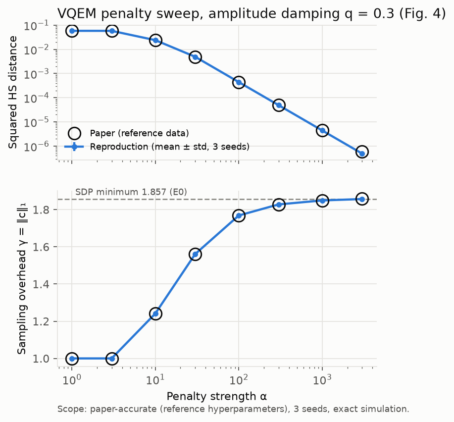
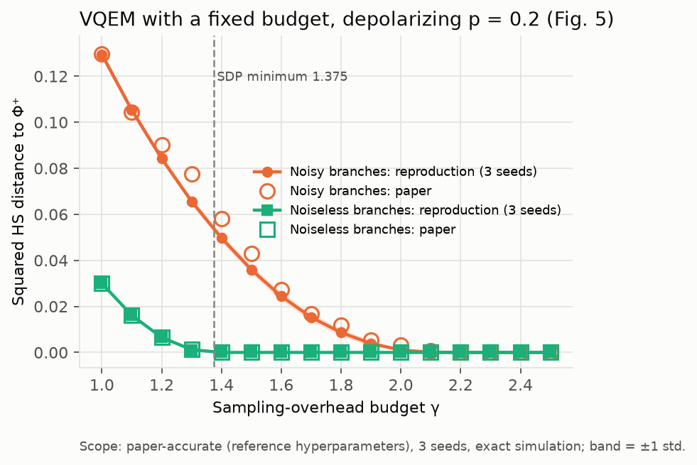
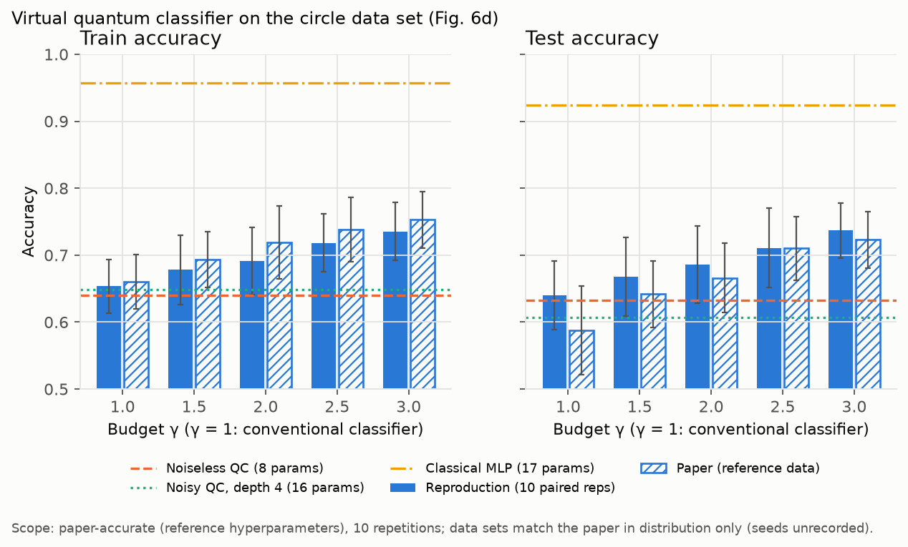
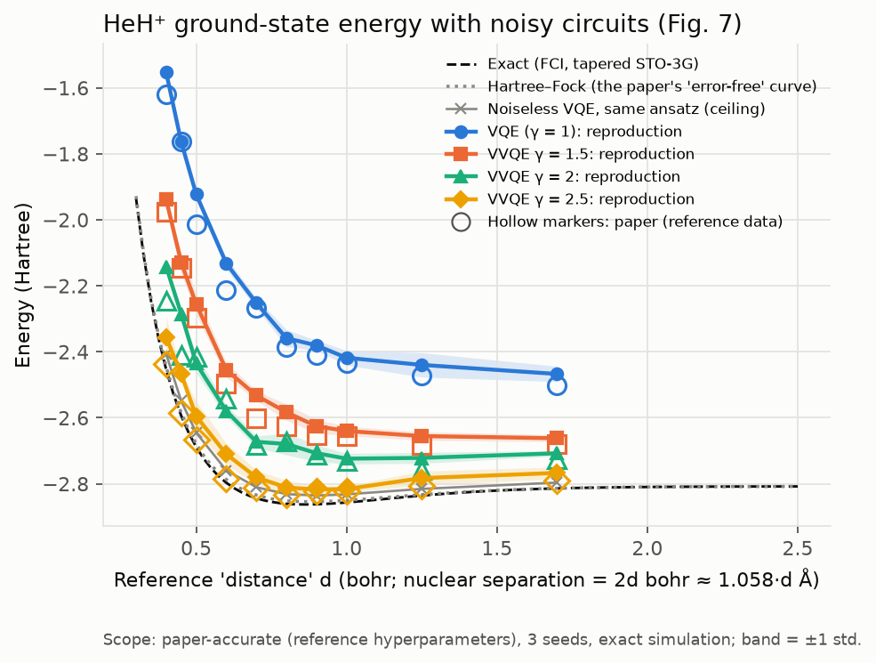
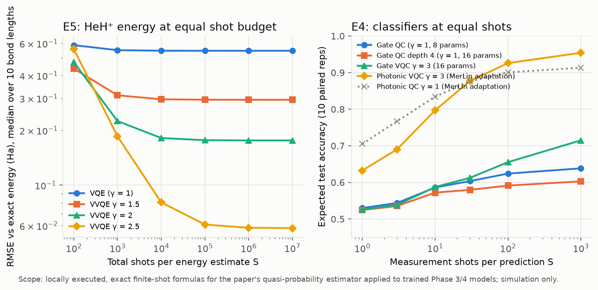
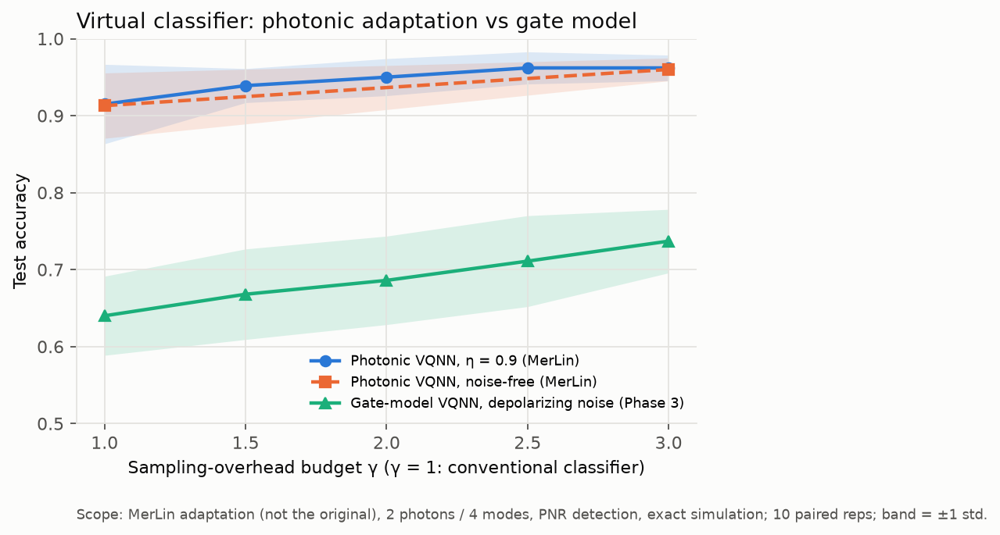

# Virtual Quantum Neural Networks — Reproduction

> Status: reproduction complete through Phase 6 (documentation).
> - E0–E5 ran at the paper's settings.
> - Fair baselines, including an equal-shot comparison, were evaluated.
> - A MerLin photonic adaptation of the classifier was evaluated
>   (`PARTIAL_MERLIN_TRANSLATION`).
>
> Overall verdict: the error-mitigation results reproduce quantitatively;
> the classifier and VVQE claims are only partially supported (see "Results
> Obtained"). Progress and decisions are recorded in [`LOG.md`](LOG.md);
> durable lessons are in [`INSIGHTS.md`](INSIGHTS.md). For a guided walkthrough
> of the claims and evidence, start with [`notebook.ipynb`](notebook.ipynb).

## Reference and Attribution

- **Paper:** B. Zhao, X. Zhao, Y. Li, Y. Li, G. Chiribella, *Virtual quantum
  neural networks*, arXiv:2609.11327v1 [quant-ph], submitted 10 Sep 2026
  (preprint): https://arxiv.org/abs/2609.11327
- **Original repository:**
  https://github.com/benchizhao/Virtual-Quantum-Neural-Network, commit
  `2bfe9d7`, QuAIRKit notebooks.
  - It has **no license file**, so it was used only as a read-only reference
    for hyperparameters and figure data.
  - No code was copied. This implementation is independent, under the root
    MIT `LICENSE`.
- **Third-party tools:** PennyLane `qml.qchem` (HeH⁺ Hamiltonian), CVXPY with
  Clarabel (SDP), MerLin / Perceval (photonic adaptation). All are used as
  dependencies.

## Original Paper

**Problem.** A quantum neural network (QNN) minimizes a loss over one
parametrized family of quantum circuits. That limits it to the CPTP maps a
shallow, noisy circuit can reach.

**Model.** A *virtual* QNN (VQNN) instead optimizes over linear combinations
M = Σᵢ cᵢ Cᵢ(θᵢ) of N parametrized channels:
- Such combinations are Hermitian-preserving, but generally not physical.
- They are realized by sampling circuit i with probability |cᵢ|/‖c‖₁ and
  reweighting each measurement outcome by ‖c‖₁·sign(cᵢ) (Eq. 6).
- The price is a sampling overhead γ = ‖c‖₁: the shots needed grow as γ²
  (Eq. 7).
- All experiments use N = 2 branches and simulated noisy circuits
  (QuAIRKit, exact expectation values).

**Experiments and metrics:**
- **Variational quantum error mitigation (VQEM)** of an unknown single-qubit
  depolarizing or amplitude-damping channel.
  - Metric: squared Hilbert–Schmidt distance between the virtual Choi state
    and a Bell state, plus the overhead γ.
  - Comparison: the optimal overhead from an SDP (Table I, Figs. 4–5).
  - Variants: noiseless and noisy branch circuits.
- **Virtual quantum classifier** on a 2D "circle" data set (200 train / 100
  test).
  - Metric: train/test accuracy against the budget γ (Fig. 6d, 10 repeats).
  - γ = 1 is the conventional classifier.
- **Virtual VQE** for the HeH⁺ dissociation curve under gate noise.
  - A Chebyshev-approximated negativity penalty keeps the virtual state
    physical.
  - Compared against noisy VQE (Fig. 7).

**Main claims:** VQNNs gain expressivity and noise robustness. In particular:
- near-optimal error mitigation;
- higher classification accuracy than conventional QNN classifiers;
- markedly more accurate noisy ground-state energies than VQE.

## Reproduction Scope, Claims, and Deviations


Planned experiments, in priority order:

| ID | Paper item | What is reproduced |
|---|---|---|
| E0 | Table I, App. D | Minimum sampling overhead (SDP) for depolarizing and amplitude-damping noise at levels 0.1–0.3 |
| E1 | Table I | VQEM Alg. 1 (penalty α=1000), noiseless 3-qubit branches with depth 10 and N=2 |
| E2 | Fig. 4 | VQEM Alg. 1 penalty sweep on amplitude damping, q=0.3 |
| E3 | Fig. 5 | VQEM Alg. 2 budget sweep, noisy vs ideal branches, depolarizing p=0.2 |
| E4 | Fig. 6d | Virtual quantum classifier accuracy vs budget, 10 repetitions; plus parameter-matched, noiseless and classical baselines |
| E5 | Fig. 7 | Virtual VQE vs noisy VQE for HeH⁺; compared with exact FCI and with Hartree–Fock |

Implementation notes and deviations (details in `LOG.md`, "Reference-code
findings"):

- **Simulator:** a torch-native density-matrix simulator written for this
  reproduction (`lib/quantum.py`). The authors used QuAIRKit; none of its code
  is copied. Exact expectation values, no shot noise, as in the paper.
- **Precision:** all experiments run in `complex128`. The authors used
  `complex64` for VQEM and VQC and `complex128` for VVQE.
- **Gradients:** autograd through the simulation, as in the paper.
- **Optimizer:** Adam + `ReduceLROnPlateau(factor=0.5)`, with the
  per-experiment learning rate and iteration count taken from the authors'
  notebooks. The paper only says "Adam".
- **Missing details** follow the authors' notebooks wherever the paper is
  silent or differs from them: the VQEM register wiring, the VQC
  encoding/ansatz/accuracy rule, the 6-qubit VVQE circuit, and the VVQE
  penalty normalization (`α·|Tr p_K(σ/γ)|`, α=10).
- **Chebyshev coefficients:** the analytic series of paper Eq. (G4) is used.
  The authors computed them by numerical quadrature; the two agree to 1e-6.
- **Parameter initialization:** uniform in [0, 2π), seeded by `seed`. QuAIRKit's
  exact initializer is not reproduced.
- **VQEM Alg. 1 coefficients:** parameterized as `(t, 1−t)` with t starting at
  2. This is inferred from the reference logs.
- **Fig. 7 axis:** the HeH⁺ "distance" d is half the separation in bohr. The
  separation is therefore 2d bohr ≈ 1.058·d Å, not the d Å on the paper's
  axis label.
- **Fig. 7 reference curve:** the paper's "exact" curve is Hartree–Fock. Errors
  are reported against both FCI and HF.
- **VQC baselines:** the conventional classifier (budget 1) uses a single
  branch, so its parameter count is reported correctly. A depth-4
  parameter-matched branch and classical baselines are added.

Claims tested, with outcomes after the fair comparison (details in `LOG.md`,
Claim Inventory):

| ID | Claim | Experiments | Outcome |
|---|---|---|---|
| C1 | Learned 2-branch quasi-probability inverses reach near-optimal sampling overhead with tiny error | E0, E1 | **Supported** (quantitative; Table I AD rows swapped) |
| C2 | A larger penalty α lowers the error while γ approaches the optimum | E2 | **Supported** (quantitative) |
| C3 | The sampling budget compensates noisy branch circuits | E3 | **Partially supported** (trend and most points reproduced; equal-shot test unresolved) |
| C4 | The virtual classifier beats the conventional classifier under noise | E4 (+ baselines, photonic, equal-shot) | **Partially supported** (reproduced at exact values; needs ≳100 shots per prediction; gain is not noise robustness; classical MLP better) |
| C5 | VVQE gives accurate ground-state energies under noise, better than VQE | E5 (+ noiseless VQE, equal-shot) | **Partially supported** (beats noisy VQE for ≳10³ shots; not accurate vs the exact energy; mean values 0–0.13 Ha off the paper) |
| C6 | VQNNs offer expressivity and noise robustness | all | **Partially supported** (benefits need enough shots; robustness not isolated) |
| C7 | Barren plateaus are neither escaped nor aggravated | — | Unresolved (analytic only, not tested) |
| C8 | Shot cost scales as ‖c‖₁² | Monte-Carlo test | **Supported** |
| C9 | LOCC combinations simulate long-range gates | — | Out of scope (no experiment in the paper) |

## Project Layout

```text
papers/virtual_qnn/
├── README.md, LOG.md, INSIGHTS.md, FEEDBACK.md, CONFLUENCE.md, VISITED_URLS.md
├── ACTION_REQUIRED_SEND_TO_MERLIN_TEAM.md   MerLin-team feedback
├── cli.json, requirements.txt
├── notebook.ipynb      executed scientific walkthrough (start here; about 80 s on CPU)
├── configs/            defaults.json, e0–e5 experiment configs, MerLin and equal-shot configs
│   └── sweeps/         sweep specs (candidates × repetitions, predeclared plan)
├── lib/
│   ├── quantum.py      density-matrix simulator (gates, depolarizing / amplitude-damping noise, partial trace)
│   ├── circuits.py     layered ansatz (paper Fig. 3), optional gate noise
│   ├── vqem.py, sdp.py error mitigation (Algs. 1–2) and the minimum-overhead SDP (App. D)
│   ├── vqc.py, classical.py   virtual quantum classifier and classical baselines
│   ├── vvqe.py         virtual VQE with Chebyshev negativity penalty (App. G)
│   ├── vqc_merlin.py   MerLin photonic adaptation of the classifier
│   ├── shot_budget.py  finite-shot statistics of the virtual estimator (Eq. 6)
│   ├── data.py         circle data set, data loader, HeH⁺ Hamiltonian (PennyLane)
│   ├── training.py, tasks.py, runner.py, settings.py, experiment_logging.py
│   └── paper_values.py paper / reference-code values used for comparison
├── utils/              run_sweep.py, summarize_sweep.py, compare_*.py, plot_*.py, export/build tables
├── tests/              simulator, data, models, MerLin, shot-budget, CLI and contract tests
├── results/            curated figures and generated comparison tables (committed)
└── outdir/             raw runs and sweeps (git-ignored)
```

## Install and How to Run


```bash
pip install -r papers/virtual_qnn/requirements.txt
```

Quick smoke runs (seconds), from the repository root:

```bash
python implementation.py --paper virtual_qnn --help
python implementation.py --paper virtual_qnn --config configs/defaults.json
python implementation.py --paper virtual_qnn --config configs/e5_vvqe_reduced.json
```

Paper settings, one configuration point per run (single examples):

```bash
python implementation.py --paper virtual_qnn --config configs/e0_sdp_original.json
python implementation.py --paper virtual_qnn --config configs/e1_vqem_penalty_original.json --noise-model amplitude_damping --noise-level 0.3 --seed 1
python implementation.py --paper virtual_qnn --config configs/e2_vqem_penalty_sweep_original.json --penalty 100 --seed 1
python implementation.py --paper virtual_qnn --config configs/e3_vqem_budget_noisy_original.json --vqem-budget 1.8 --seed 1
python implementation.py --paper virtual_qnn --config configs/e4_vqc_original.json --vqc-budget 2.5 --seed 3 --seed-data 3
python implementation.py --paper virtual_qnn --config configs/e4_vqc_classical.json --classical-kind mlp --seed-data 3
python implementation.py --paper virtual_qnn --config configs/e5_vvqe_original.json --half-distance 0.8 --vvqe-budget 2.5 --seed 1
```

From inside `papers/virtual_qnn`, use
`python ../../implementation.py --config configs/<experiment>.json`.

**Reproduce all results.** Sweeps run one process per candidate ×
repetition, with 6 workers, into `outdir/sweeps/<sweep_id>/`. The full
pipeline took about 45 minutes on an Apple M2 CPU.

```bash
python implementation.py --paper virtual_qnn --config configs/e0_sdp_original.json --seed 0 --outdir papers/virtual_qnn/outdir/e0_sdp
for s in e1_vqem_penalty e2_vqem_penalty_sweep e3_vqem_budget_noisy e3_vqem_budget_ideal e4_vqc_budget e4_vqc_baselines e5_vvqe e5_vqe_noiseless e4_vqc_merlin_budget_enc01 e4_vqc_merlin_noiseless_enc01; do
  python papers/virtual_qnn/utils/run_sweep.py papers/virtual_qnn/configs/sweeps/$s.json
done
python implementation.py --paper virtual_qnn --config configs/e5_equal_shot_classical.json --seed 0 --outdir papers/virtual_qnn/outdir/phase5/e5_equal_shot
python implementation.py --paper virtual_qnn --config configs/e4_equal_shot_classical.json --seed 0 --outdir papers/virtual_qnn/outdir/phase5/e4_equal_shot
```

Then regenerate the tables and figures from the structured artifacts:
- `utils/compare_with_paper.py` produces `results/comparison.*`;
- `utils/plot_fig4_penalty.py`, `utils/plot_fig5_budget.py`,
  `utils/plot_fig6_vqc.py` and `utils/plot_fig7_vvqe.py` produce the figures;
- `utils/compare_merlin.py` and `utils/compare_fair.py` produce the photonic
  and equal-shot comparisons;
- `utils/export_sweep_tables.py` and `utils/build_results_table.py` produce
  `results/sweep_tables.md` and `results/results_summary.md`.

Each script's docstring gives its exact arguments, and `LOG.md` records the
commands that were run.

Each run writes `outdir/run_YYYYMMDD-HHMMSS/` containing:
- `run.log`: lifecycle events and per-iteration progress;
- `run_status.json`: structured status;
- `config_snapshot.json`: the resolved configuration;
- `metrics.json`: final metrics;
- `losses.csv`: per-iteration history;
- task artifacts: `model_state.pt`, `virtual_state.npz`, `dataset.npz`.

## Configuration


`cli.json` is the authoritative CLI schema. Paper-specific flags:
`--task`, `--iterations`, `--lr`, `--noise-model`, `--noise-level`,
`--penalty`, `--vqem-budget`, `--vqc-budget`, `--seed-data`,
`--classical-kind`, `--vvqe-budget`, `--half-distance`, `--experiment-id`,
`--sweep-id`, `--repetition`, `--run-id`, `--vqc-merlin-budget`. The shared runtime adds `--config`, `--outdir`,
`--seed`, `--dtype`, `--device`, `--log-level` and `--data-root`.

| Config | Purpose |
|---|---|
| `defaults.json` | Lightweight runnable default: shallow VQEM Alg. 1, 40 iterations. It lists every key each task requires |
| `e0_sdp_original.json` | E0 SDP minimum overheads (all six channels in one run) |
| `e1_vqem_penalty_original.json` | E1 VQEM Alg. 1, paper settings |
| `e2_vqem_penalty_sweep_original.json` | E2 base point (AD q=0.3); sweep `--penalty` |
| `e3_vqem_budget_noisy_original.json` / `e3_vqem_budget_ideal_original.json` | E3 noisy / ideal branches; sweep `--vqem-budget` |
| `e4_vqc_original.json` | E4 VQC, paper settings; sweep `--vqc-budget`, `--seed`, `--seed-data` |
| `e4_vqc_param_matched.json`, `e4_vqc_noiseless.json`, `e4_vqc_classical.json` | E4 baselines |
| `e5_vvqe_original.json` | E5 VVQE, paper settings; sweep `--half-distance`, `--vvqe-budget`, `--seed` |
| `e5_vqe_noiseless.json` | E5 noiseless-VQE baseline |
| `e5_vvqe_reduced.json` | E5 smoke settings (not a paper result) |
| `e4_equal_shot_classical.json`, `e5_equal_shot_classical.json` | Phase 5 equal-shot fair control (task `equal_shot_eval`; reads the Phase 3/4 sweeps under `outdir/sweeps/`) |
| `e4_vqc_merlin.json`, `e4_vqc_merlin_noiseless.json` | Phase 4 MerLin photonic **adaptation** of E4 (noisy / noise-free); flag `--vqc-merlin-budget` |

## Data


This paper has no downloadable dataset. Every input is generated:

- VQEM (Table I, Figs. 4–5): analytic single-qubit depolarizing and
  amplitude-damping channels.
- VQC (Fig. 6): the authors' 2D "circle" dataset. Points are uniform on
  [−1,1]², label 0 if ‖x‖ < 0.7, otherwise label 1, with 200 train / 100 test
  points. It is regenerated at run time with an explicitly logged seed. The
  authors drew a random, unrecorded seed per run, so our datasets match theirs
  in distribution but not point by point.
- VVQE (Fig. 7): the HeH⁺ Hamiltonian, built with PennyLane `qml.qchem`
  (STO-3G, Jordan–Wigner) and tapered to 2 qubits. It needs `pennylane`, but no
  data download.

The generation rules come from the authors' notebooks
(https://github.com/benchizhao/Virtual-Quantum-Neural-Network, commit
`2bfe9d7`, no license, used read-only). A local reference copy is at
`data/virtual_qnn/sources/repo_snapshot/` (git-ignored). See `LOG.md`, section
"Data Acquisition Log", for provenance and verification.

## Results Obtained and Comparison with the Paper

The per-item table below is generated by `utils/build_results_table.py`.
The full candidate tables for every sweep, with declared metric, direction,
checkpoint, aggregation, run counts and coverage, are in
[`results/sweep_tables.md`](results/sweep_tables.md). All sweeps are
complete and descriptive, so no candidate is selected; one superseded
photonic sweep and two diagnostic sweeps are labelled there.

Paper values: Table I and the authors' figure data. Reproduced values: mean over repetitions, paper-accurate settings, exact simulation. Agreement criteria were predeclared (LOG.md, Sweep Plans). Claim support reflects the Phase 5 fair comparison.

| Paper item | Claim tested | Paper value | Reproduced value | Delta | Metric agreement | Trend agreement | Claim support | Seeds | Comment |
|---|---|---:|---:|---:|---|---|---|---:|---|
| Table I, minimum overhead | C1 | 1.1667 | 1.16667 | -0.0000 | yes | n/a | SUPPORTED | 1 (deterministic SDP) | depolarizing 0.1 |
| Table I, minimum overhead | C1 | 1.375 | 1.37500 | -0.0000 | yes | n/a | SUPPORTED | 1 (deterministic SDP) | depolarizing 0.2 |
| Table I, minimum overhead | C1 | 1.643 | 1.64286 | -0.0001 | yes | n/a | SUPPORTED | 1 (deterministic SDP) | depolarizing 0.3 |
| Table I, minimum overhead | C1 | 1.218 | 1.22222 | +0.0042 | no (rows swapped) | n/a | SUPPORTED | 1 (deterministic SDP) | amplitude_damping 0.1; our optimum equals Table I's 'VQEM' row |
| Table I, minimum overhead | C1 | 1.49467 | 1.50000 | +0.0053 | no (rows swapped) | n/a | SUPPORTED | 1 (deterministic SDP) | amplitude_damping 0.2; our optimum equals Table I's 'VQEM' row |
| Table I, minimum overhead | C1 | 1.849 | 1.85714 | +0.0081 | no (rows swapped) | n/a | SUPPORTED | 1 (deterministic SDP) | amplitude_damping 0.3; our optimum equals Table I's 'VQEM' row |
| Table I, VQEM overhead γ | C1 | 1.1667 | 1.1822 | +0.0155 | no (+1.33% vs optimum) | n/a | SUPPORTED | 3 | depolarizing 0.1; vs SDP optimum 1.1667 |
| Table I, HS² error | C1 | 9.53e-07 | 1.19e-06 | +2.3e-07 | yes | n/a | SUPPORTED | 3 | depolarizing 0.1 |
| Table I, VQEM overhead γ | C1 | 1.372 | 1.3788 | +0.0068 | yes | n/a | SUPPORTED | 3 | depolarizing 0.2; vs SDP optimum 1.3750 |
| Table I, HS² error | C1 | 1.33e-06 | 1.19e-06 | -1.4e-07 | yes | n/a | SUPPORTED | 3 | depolarizing 0.2 |
| Table I, VQEM overhead γ | C1 | 1.644 | 1.6461 | +0.0021 | yes | n/a | SUPPORTED | 3 | depolarizing 0.3; vs SDP optimum 1.6429 |
| Table I, HS² error | C1 | 1.55e-06 | 1.53e-06 | -2.1e-08 | yes | n/a | SUPPORTED | 3 | depolarizing 0.3 |
| Table I, VQEM overhead γ | C1 | 1.222 | 1.2256 | +0.0036 | yes | n/a | SUPPORTED | 3 | amplitude_damping 0.1; vs SDP optimum 1.2222; AD: matches Table I 'Minimum' row |
| Table I, HS² error | C1 | 2.62e-06 | 2.65e-06 | +3.3e-08 | yes | n/a | SUPPORTED | 3 | amplitude_damping 0.1 |
| Table I, VQEM overhead γ | C1 | 1.5 | 1.4946 | -0.0054 | yes | n/a | SUPPORTED | 3 | amplitude_damping 0.2; vs SDP optimum 1.5000; AD: matches Table I 'Minimum' row |
| Table I, HS² error | C1 | 3.34e-06 | 3.23e-06 | -1.1e-07 | yes | n/a | SUPPORTED | 3 | amplitude_damping 0.2 |
| Table I, VQEM overhead γ | C1 | 1.857 | 1.8492 | -0.0078 | yes | n/a | SUPPORTED | 3 | amplitude_damping 0.3; vs SDP optimum 1.8571; AD: matches Table I 'Minimum' row |
| Table I, HS² error | C1 | 4.53e-06 | 4.43e-06 | -9.6e-08 | yes | n/a | SUPPORTED | 3 | amplitude_damping 0.3 |
| Fig. 4, α = 10 | C2 | γ 1.2410; HS² 2.40e-02 | γ 1.2411; HS² 2.40e-02 | Δγ +0.0001; HS² ×1.00 | yes | yes | SUPPORTED | 3 | AD q = 0.3; all 8 α in sweep_tables.md |
| Fig. 4, α = 100 | C2 | γ 1.7679; HS² 4.48e-04 | γ 1.7683; HS² 4.44e-04 | Δγ +0.0004; HS² ×0.99 | yes | yes | SUPPORTED | 3 | AD q = 0.3; all 8 α in sweep_tables.md |
| Fig. 4, α = 1000 | C2 | γ 1.8487; HS² 4.53e-06 | γ 1.8492; HS² 4.43e-06 | Δγ +0.0004; HS² ×0.98 | yes | yes | SUPPORTED | 3 | AD q = 0.3; all 8 α in sweep_tables.md |
| Fig. 4, α = 3000 | C2 | γ 1.8580; HS² 5.96e-07 | γ 1.8567; HS² 4.94e-07 | Δγ -0.0013; HS² ×0.83 | yes | yes | SUPPORTED | 3 | AD q = 0.3; all 8 α in sweep_tables.md |
| Fig. 5, noisy, γ = 1.0 | C3 | 0.1298 | 0.1295 | -0.0003 | yes | yes | PARTIALLY_SUPPORTED (equal-shot test unresolved) | 3 | depolarizing p = 0.2 |
| Fig. 5, noisy, γ = 1.3 | C3 | 0.0777 | 0.0656 | -0.0120 | no | yes | PARTIALLY_SUPPORTED (equal-shot test unresolved) | 3 | authors' own runs differ by 0.013 at γ = 1.3 |
| Fig. 5, noisy, γ = 1.5 | C3 | 0.0430 | 0.0359 | -0.0070 | yes | yes | PARTIALLY_SUPPORTED (equal-shot test unresolved) | 3 | depolarizing p = 0.2 |
| Fig. 5, noisy, γ = 2.0 | C3 | 0.0032 | 0.0011 | -0.0021 | yes | yes | PARTIALLY_SUPPORTED (equal-shot test unresolved) | 3 | depolarizing p = 0.2 |
| Fig. 5, noisy, first γ with HS² < 1e-4 | C3 | 2.3 | 2.1 | -0.2 | no | yes | PARTIALLY_SUPPORTED | 3 | SDP minimum 1.375 |
| Fig. 5, ideal, γ = 1.0 | C3 | 0.0300 | 0.0300 | -0.0000 | yes | yes | PARTIALLY_SUPPORTED (equal-shot test unresolved) | 3 | depolarizing p = 0.2 |
| Fig. 5, ideal, γ = 1.3 | C3 | 0.0012 | 0.0012 | -0.0000 | yes | yes | PARTIALLY_SUPPORTED (equal-shot test unresolved) | 3 | depolarizing p = 0.2 |
| Fig. 5, ideal, γ = 1.5 | C3 | 0.0000 | 0.0000 | -0.0000 | yes | yes | PARTIALLY_SUPPORTED (equal-shot test unresolved) | 3 | depolarizing p = 0.2 |
| Fig. 5, ideal, γ = 2.0 | C3 | 0.0000 | 0.0000 | -0.0000 | yes | yes | PARTIALLY_SUPPORTED (equal-shot test unresolved) | 3 | depolarizing p = 0.2 |
| Fig. 5, ideal, first γ with HS² < 1e-4 | C3 | 1.4 | 1.4 | +0.0 | yes | yes | PARTIALLY_SUPPORTED | 3 | SDP minimum 1.375 |
| Fig. 6d, γ = 1.0 | C4 | test 0.588 ± 0.066 | test 0.640 ± 0.051 | +0.052 | yes (within 1 paper std) | yes | PARTIALLY_SUPPORTED (needs ≳100 shots; not noise robustness) | 10 paired | train 0.653 vs paper 0.660; data match in distribution only |
| Fig. 6d, γ = 1.5 | C4 | test 0.642 ± 0.050 | test 0.668 ± 0.059 | +0.026 | yes (within 1 paper std) | yes | PARTIALLY_SUPPORTED (needs ≳100 shots; not noise robustness) | 10 paired | train 0.678 vs paper 0.694; data match in distribution only |
| Fig. 6d, γ = 2.0 | C4 | test 0.666 ± 0.052 | test 0.686 ± 0.057 | +0.020 | yes (within 1 paper std) | yes | PARTIALLY_SUPPORTED (needs ≳100 shots; not noise robustness) | 10 paired | train 0.691 vs paper 0.719; data match in distribution only |
| Fig. 6d, γ = 2.5 | C4 | test 0.710 ± 0.048 | test 0.711 ± 0.059 | +0.001 | yes (within 1 paper std) | yes | PARTIALLY_SUPPORTED (needs ≳100 shots; not noise robustness) | 10 paired | train 0.718 vs paper 0.738; data match in distribution only |
| Fig. 6d, γ = 3.0 | C4 | test 0.723 ± 0.042 | test 0.737 ± 0.041 | +0.014 | yes (within 1 paper std) | yes | PARTIALLY_SUPPORTED (needs ≳100 shots; not noise robustness) | 10 paired | train 0.736 vs paper 0.753; data match in distribution only |
| Fig. 7, d = 0.45, γ = 1.0 | C5 | -1.7634 | -1.7631 (best of 3: -1.7790) | +0.0003 | yes | yes | PARTIALLY_SUPPORTED | 3 | |E − E_FCI| = 0.830 Ha; paper curve is HF |
| Fig. 7, d = 0.45, γ = 2.5 | C5 | -2.5863 | -2.4669 (best of 3: -2.4746) | +0.1194 | no | yes | PARTIALLY_SUPPORTED | 3 | |E − E_FCI| = 0.127 Ha; paper curve is HF |
| Fig. 7, d = 0.8, γ = 1.0 | C5 | -2.3870 | -2.3587 (best of 3: -2.3899) | +0.0284 | best-of-3 only | yes | PARTIALLY_SUPPORTED | 3 | |E − E_FCI| = 0.502 Ha; paper curve is HF |
| Fig. 7, d = 0.8, γ = 2.5 | C5 | -2.8327 | -2.8113 (best of 3: -2.8312) | +0.0214 | best-of-3 only | yes | PARTIALLY_SUPPORTED | 3 | |E − E_FCI| = 0.049 Ha; paper curve is HF |
| Fig. 7, d = 1.7, γ = 1.0 | C5 | -2.5026 | -2.4672 (best of 3: -2.4891) | +0.0354 | best-of-3 only | yes | PARTIALLY_SUPPORTED | 3 | |E − E_FCI| = 0.347 Ha; paper curve is HF |
| Fig. 7, d = 1.7, γ = 2.5 | C5 | -2.7900 | -2.7671 (best of 3: -2.7900) | +0.0229 | best-of-3 only | yes | PARTIALLY_SUPPORTED | 3 | |E − E_FCI| = 0.047 Ha; paper curve is HF |
| Fig. 7, all 40 points | C5 | — | 13/40 within 0.02 Ha (mean), 24/40 (best of 3) | median |Δ| 0.029 Ha | no | yes (10/10 distances ordered) | PARTIALLY_SUPPORTED | 3 | gap diagnosed: not iteration budget; best-of-N insufficient (LOG.md) |


Every number below comes from exact (noise-channel, density-matrix) simulation, as in the paper. Reproduction values are mean ± population std over repetitions, generated by `utils/compare_with_paper.py` from the sweep `summary.json` files (full tables: [`results/comparison.md`](results/comparison.md)). Paper values are Table I and the exact data arrays behind Figs. 4–7 in the authors' notebooks.

Scope labels: E0–E5 are **paper-accurate** (reference hyperparameters, full protocol): 3 seeds (E1–E3, E5) or 10 paired repetitions (E4). E4 data sets match the paper in distribution only, since the authors' data seeds were not recorded. The E5 best-of-10 and 600-iteration runs are **diagnostic**.

| Claim | Experiment | Verdict |
|---|---|---|
| Learned quasi-probability inverses reach near-optimal overhead (C1) | E0, E1 (Table I) | **Quantitatively reproduced.** One exception: depolarizing p = 0.1 is +1.3% above the optimum because of the finite iteration budget |
| Penalty trades error for overhead (C2) | E2 (Fig. 4) | **Quantitatively reproduced** |
| Sampling budget compensates noisy circuits (C3) | E3 (Fig. 5) | **Trend reproduced.** 31/32 points within ±0.01 |
| Virtual classifier beats the conventional one under noise (C4) | E4 (Fig. 6d) | **Quantitatively reproduced, interpretation qualified** (see baselines) |
| VVQE gives accurate ground-state energies under noise (C5) | E5 (Fig. 7) | **Partially supported.** The trend is reproduced, but there is no accuracy relative to the exact energy, and the mean metric gap is partly unexplained |

### E0 + E1 — error mitigation with N = 2 noiseless branches (Table I)

| Channel | HS² (ours) | HS² (paper) | γ (ours) | γ optimum (SDP) | γ Table I 'VQEM' | γ Table I 'Minimum' |
|---|---:|---:|---:|---:|---:|---:|
| depolarizing 0.1 | 1.19e-06 | 9.53e-07 | 1.1822 ± 0.0089 | 1.1667 | 1.1667 | 1.1667 |
| depolarizing 0.2 | 1.19e-06 | 1.33e-06 | 1.3788 ± 0.0058 | 1.3750 | 1.372 | 1.375 |
| depolarizing 0.3 | 1.53e-06 | 1.55e-06 | 1.6461 ± 0.0034 | 1.6429 | 1.644 | 1.643 |
| amplitude_damping 0.1 | 2.65e-06 | 2.62e-06 | 1.2256 ± 0.0042 | 1.2222 | 1.222 | 1.218 |
| amplitude_damping 0.2 | 3.23e-06 | 3.34e-06 | 1.4946 ± 0.0001 | 1.5000 | 1.5 | 1.49467 |
| amplitude_damping 0.3 | 4.43e-06 | 4.53e-06 | 1.8492 ± 0.0002 | 1.8571 | 1.857 | 1.849 |

Our SDP reproduces the depolarizing optimum (1+p/2)/(1−p) exactly. For amplitude damping, the true optimum (1.2222/1.5000/1.8571) equals Table I's *VQEM* row. Our trained overheads (1.4946/1.8492) match Table I's *Minimum* row, which lies below the optimum because the inversion is approximate. **The two amplitude-damping rows of Table I appear swapped.**

### E2 — penalty sweep (Fig. 4)



All eight penalty values agree with the authors' data: HS² ratio 0.83–1.00, |Δγ| ≤ 0.0013. γ rises to 1.8567 at α = 3000, against the optimum 1.8571.

### E3 — fixed-budget mitigation with noisy vs noiseless branches (Fig. 5)



The noiseless-branch curve matches the authors' data to four digits. Their curve floors at about 2e-7 because of complex64 precision; ours reaches about 1e-28. The noisy-branch curve first drops below HS² = 1e-4 at γ = 2.1, vs 2.3 in the paper. The ideal curve does so at 1.4 in both. The one point outside ±0.01 (γ = 1.3, −0.012) is within the spread between the authors' own two runs of this sweep.

### E4 — virtual quantum classifier (Fig. 6d)



| γ | Params | Train (ours) | Train (paper) | Test (ours) | Test (paper) |
|---:|---:|---:|---:|---:|---:|
| 1.0 | 8 | 0.653 ± 0.040 | 0.660 ± 0.040 | 0.640 ± 0.051 | 0.588 ± 0.066 |
| 1.5 | 16 | 0.678 ± 0.052 | 0.694 ± 0.042 | 0.668 ± 0.059 | 0.642 ± 0.050 |
| 2.0 | 16 | 0.691 ± 0.050 | 0.719 ± 0.054 | 0.686 ± 0.057 | 0.666 ± 0.052 |
| 2.5 | 16 | 0.718 ± 0.043 | 0.738 ± 0.048 | 0.711 ± 0.059 | 0.710 ± 0.048 |
| 3.0 | 16 | 0.736 ± 0.043 | 0.753 ± 0.042 | 0.737 ± 0.041 | 0.723 ± 0.042 |

All means are within one paper std. Paired over the same 10 data sets, γ = 3 improves test accuracy over γ = 1 by +0.097 (t = 7.5, p = 4e-05, 10/10 pairs). Baselines added for a fair reading:

| Baseline (same data) | Params | Test accuracy | VQC(γ=3) − baseline (paired) |
|---|---:|---:|---|
| Noisy QC, one branch, depth 4 | 16 | 0.607 ± 0.071 | +0.130 (p = 0.0002) |
| Noiseless conventional QC | 8 | 0.632 ± 0.049 | +0.105 (p = 3e-05) |
| Classical MLP 2-4-1 | 17 | 0.924 ± 0.027 | -0.187 (p = 2e-06) |
| Logistic regression (linear floor) | 3 | 0.587 ± 0.085 | +0.150 (p = 0.0006) |

The parameter-matched single circuit does not improve on γ = 1, so the gain is not just extra parameters. The *noiseless* conventional classifier is no better than the noisy one, so the gain is not noise robustness, as the paper frames it. It comes from the richer combined readout (a signed combination of two circuits). A 17-parameter MLP solves the task far better, so no quantum advantage is implied.

### E5 — virtual VQE for HeH⁺ (Fig. 7)



The ordering E(γ=2.5) < E(γ=1.5) < E(γ=1) holds at 10/10 bond lengths. Agreement with the paper's points within 0.02 Ha: 13/40 by mean, 24/40 by best-of-3. Median |Δ|: 0.029 Ha by mean, 0.015 Ha by best-of-3.

Three findings change how Fig. 7 should be read:

1. **The paper's 'error-free' curve is the Hartree–Fock energy, not the exact ground state.** The authors' plotting code computes the HF expectation of the tapered Hamiltonian. Against exact diagonalization (FCI), VVQE at γ = 2.5 is still 0.04–0.13 Ha too high, far from chemical accuracy (1.6 mHa).
2. **The ansatz itself caps the accuracy.** Noiseless VQE with the same 6-qubit circuit stops 0.018–0.047 Ha above FCI, sometimes above HF. VVQE at γ = 2.5 recovers roughly this noiseless level, so the virtual combination works as error mitigation, but it cannot exceed what the noiseless circuit can do.
3. **Distance axis.** The authors' "distance" d places the atoms at ±d bohr, so the separation is 2d bohr ≈ 1.058·d Å, not d Å.

The mean energies are 0.00–0.13 Ha above the paper's points. A predeclared diagnosis ruled out the iteration budget (600 iterations close ≤ 9% of the gap). It also showed that best-of-N selection alone cannot explain the gap: at 3/6 tested points the paper value is better than all 10 of our seeds. The most likely remaining cause is the optimizer landscape and initialization on a multimodal noisy 6-qubit circuit; QuAIRKit's initializer is not reproduced. The diagnosis is recorded in `LOG.md`.

## Fair Baselines

Baselines used for each claim:
- **C1/C2:** the provable optimum from the App. D SDP (E0).
- **C4:**
  - a parameter-matched single noisy circuit (depth 4, 16 parameters) and a
    noiseless conventional classifier;
  - a classical 2-4-1 MLP and logistic regression, with the learning rate
    chosen on a validation split;
  - all on the same 10 data sets (see the E4 results above).
- **C5:** noiseless VQE with the same ansatz (the ceiling of the circuit
  family), plus exact diagonalization (FCI) and Hartree–Fock references.
- **C4 and C5, equal shot budgets:** described below.

### Equal shot budgets


Every comparison in the paper, and in Phase 3, uses *exact* expectation
values. That hides the main cost of a virtual QNN. Its estimator (paper
Eq. 6) samples one of the circuits with probability |cᵢ|/γ and reweights
each ±1 outcome by ±γ. It is unbiased, but its per-shot variance is
**γ² − ⟨P⟩²** instead of 1 − ⟨P⟩² (checked by Monte-Carlo in
`tests/test_shot_budget.py`). The fair control re-evaluates the *trained*
Phase 3 and Phase 4 models at **equal measurement-shot budgets**, using exact
finite-shot formulas. The comparison plan was frozen before any result
(`LOG.md`, "Phase 5 Comparison Plan"). Full tables:
[`results/fair_comparison.md`](results/fair_comparison.md).



**E5, HeH⁺ energy** (RMSE vs the exact energy; median over 10 bond lengths of
the 3-seed mean):

| Total shots S | VQE (γ=1) | VVQE γ=1.5 | VVQE γ=2.5 | VVQE γ=2.5 better than VQE at |
|---:|---:|---:|---:|---|
| 10² | 0.587 | 0.437 | 0.558 | 7/10 distances |
| 10³ | 0.551 | 0.312 | 0.185 | 10/10 |
| 10⁵ | 0.547 | 0.295 | 0.061 | 10/10 |

Noisy VQE is biased by about 0.55 Ha, so VVQE wins at equal shots once
S ≳ 10³. Even with unlimited shots it remains ≥ 0.058 Ha (median) from the
exact energy.

**E4, classifiers** (expected test accuracy with S shots per prediction, 10
paired repetitions):

| S | Gate QC γ=1 (8 params) | Gate QC depth 4 (16 params) | Gate VQC γ=3 (16 params) | Photonic QC γ=1 | Photonic VQC γ=3 |
|---:|---:|---:|---:|---:|---:|
| 1 | 0.530 | 0.524 | 0.526 | 0.705 | 0.632 |
| 10 | 0.586 | 0.572 | 0.587 | 0.834 | 0.797 |
| 100 | 0.624 | 0.591 | 0.655 | 0.901 | 0.926 |
| 1000 | 0.638 | 0.603 | 0.715 | 0.913 | 0.954 |
| ∞ | 0.640 | 0.607 | 0.737 | 0.915 | 0.962 |

Paired, gate VQC γ=3 − QC γ=1:
- S = 1: -0.004 (p = 0.037);
- S = 100: +0.031 (p = 0.016);
- S = 1000: +0.076 (p = 0.00013).

Photonic γ=3 − γ=1:
- S = 1: -0.073 (p = 4.3e-07);
- S = 1000: +0.041 (p = 0.019).

The virtual classifier needs at least about 100 (gate) or 1000 (photonic)
shots per prediction to beat the conventional one. With fewer shots it is
worse, because the γ²-inflated variance swamps the gain.

**Claim outcomes after the fair comparison:**
- **C1/C2:** SUPPORTED. Near-optimal mitigation overhead against the provable
  SDP baseline.
- **C3:** PARTIALLY_SUPPORTED. The equal-shot test is unresolved, because the
  paper specifies no measurement protocol for its HS² metric.
- **C4:** PARTIALLY_SUPPORTED. The advantage holds only with S ≳ 100 shots
  per prediction. It comes from the combined readout, not noise robustness.
  A 17-parameter classical MLP beats every gate model.
- **C5:** PARTIALLY_SUPPORTED. VVQE beats noisy VQE at equal shots for
  S ≳ 10³, but it is not accurate relative to the exact energy.
- **C8:** SUPPORTED. Shot cost scales with γ².

No quantum or photonic advantage is claimed.

Compute and timing (Apple M2, CPU, 6 single-threaded workers, including
process start-up):
- E4 classifier runs: about 5–7 s each;
- E5 VVQE runs: about 59 s each (noiseless VQE: about 25 s);
- equal-shot evaluations: about 6 s each.

## Photonic Assessment and MerLin Extension


**Status: `PARTIAL_MERLIN_TRANSLATION`.** This section is an *adaptation*,
not part of the original reproduction. Details: `LOG.md` (Phase 4 sections)
and [`results/merlin_comparison.md`](results/merlin_comparison.md).

The VQNN mechanism, a signed combination of two noisy trainable circuits
estimated by sampling, does not depend on the hardware platform. What has to
be preserved is the claim that accuracy improves with the budget γ under
realistic hardware noise.

| Paper part | Photonic mapping | Decision |
|---|---|---|
| E4 virtual classifier | Two MerLin branches: 2 photons in 4 modes, trainable MZI meshes, (x1, x2) phase-encoded on modes 0–1, photon-number parity readout, partial-distinguishability noise | **Implemented and evaluated** on the same data, splits, budgets, paired seeds and training protocol |
| E0–E3 error mitigation | Needs arbitrary 3-qubit channels with traced-out ancillas on dual-rail qubits, plus a single-qubit noise channel | **Rejected** (architectural). Passive linear optics cannot implement these channels without heralded entangling gates, and photonic noise (loss, distinguishability) is not a single-qubit channel. A photonic-native formulation would be new research |
| E5 virtual VQE | Dual-rail 2-qubit state with Pauli-basis measurement interferometers, manual postselection and tomography | **Deferred** (feasible, substantial engineering; out of the agreed scope) |



| Model (10 paired reps) | Test, γ = 1 | Test, γ = 3 | Paired γ3 − γ1 |
|---|---:|---:|---|
| Photonic VQNN, indistinguishability 0.9 | 0.915 ± 0.052 | 0.962 ± 0.017 | +0.047 (p = 0.013) |
| Photonic VQNN, noise-free | 0.913 ± 0.042 | 0.960 ± 0.015 | +0.047 (p = 0.0084) |
| Gate-model VQNN (Phase 3) | 0.640 ± 0.051 | 0.737 ± 0.041 | +0.097 (p = 4e-05) |

- **The budget trend carries over to photonics.** Under the predeclared rule,
  test accuracy is monotone in γ and γ = 3 beats γ = 1 by more than the
  pooled std, with p < 0.05.
- **The gain does not come from noise robustness.** It is the same with and
  without distinguishability noise, and the noise itself has no measurable
  effect on accuracy (noise-free − noisy at γ = 1:
  -0.002,
  p = 0.68).
  As in the gate model, the gain comes from the richer combined readout.
- **The photonic classifier is far more accurate than the gate-model one**
  (0.915 vs 0.640 at γ = 1). This reflects a different feature map and
  circuit family, not a photonic advantage. It is similar to a 17-parameter
  classical MLP (0.924), and the γ² shot cost is not included. A cost-matched
  comparison is Phase 5 work.

Hardware-aware settings are in the next section.

Two design pitfalls were caught by tests before any evidence run and fixed:
1. A readout linear in the mean photon numbers is blind to photon
   distinguishability and to two-photon interference.
2. Encoding the same features on all modes makes a passive interferometer's
   output depend only on x1 − x2, because of global-phase invariance.

A first sweep with the second defect is kept as *superseded* evidence.

Run it:

```bash
python implementation.py --paper virtual_qnn --config configs/e4_vqc_merlin.json --vqc-merlin-budget 3.0 --seed 1 --seed-data 1
python implementation.py --paper virtual_qnn --config configs/e4_vqc_merlin_noiseless.json --vqc-merlin-budget 3.0 --seed 1 --seed-data 1
python papers/virtual_qnn/utils/run_sweep.py papers/virtual_qnn/configs/sweeps/e4_vqc_merlin_budget_enc01.json
```

## Hardware-Aware Settings

Applies to the executed MerLin configurations `configs/e4_vqc_merlin.json`
(sweep `e4_vqc_merlin_budget_enc01`, γ ∈ {1, 1.5, 2, 2.5, 3}) and
`configs/e4_vqc_merlin_noiseless.json` (sweep
`e4_vqc_merlin_noiseless_enc01`, γ ∈ {1, 3}).

| Field | Noisy configuration | Noise-free control |
|---|---|---|
| Computation space | `ComputationSpace.FOCK` | `ComputationSpace.FOCK` |
| Detector model | photon-number-resolving (required by MerLin for distinguishability noise) | photon-number-resolving |
| Photon number | 2 per branch | 2 per branch |
| Number of modes | 4 per branch | 4 per branch |
| Input state | \|1,0,1,0⟩ | \|1,0,1,0⟩ |
| Encoding | (x1, x2)·π phase encoding on modes 0–1, between two trainable meshes | same |
| Measurement strategy | `MeasurementStrategy.probs(FOCK)` → parity (−1)^(n0+n1) | same |
| Postselection | none | none |
| Noise model | `pcvl.NoiseModel(indistinguishability=0.9)` | none |
| Simulator / QPU | MerLin 0.4.1 exact CPU simulation; simulated only | same |
| Shot count | n/a for training/evaluation (exact); finite-shot behaviour in Fair Baselines | same |
| Gradients | exact autograd | exact autograd |
| Wall-clock | ≈ 6 s per run (median, incl. start-up), Apple M2 CPU | ≈ 6 s |
| Seeds | seed = seed_data = r, r = 1..10 | same |
| Trainable parameters | 24 phases per branch | same |

## Limitations


- Training uses exact expectation values, as in the paper. The equal-shot
  comparison (Phase 5) applies exact finite-shot statistics to the *trained*
  models; training itself under shot noise is not studied. C3 (error
  mitigation) has no equal-shot test.
- E5 metric agreement is not established (see above). The optimizer
  initializer differs from QuAIRKit's.
- E4 data sets match the paper in distribution only.
- The App. A barren-plateau argument and the App. I LOCC simulation are not
  tested numerically.
- The photonic adaptation covers only E4. It uses one noise level (η = 0.9),
  no loss or phase noise, and is simulated only.

## Tests

```bash
cd papers/virtual_qnn
pytest -q          # 42 tests
```

The tests cover:
- `test_quantum.py`: simulator primitives against explicit matrices;
- `test_data.py`: the one-batch data loader, the data rule, and the HeH⁺
  Hamiltonian against the reference FCI;
- `test_models.py`: VQEM, VQC and VVQE behaviour, and SDP closed forms;
- `test_vqc_merlin.py`:
  - photonic shapes, gradients and seeding;
  - noise reaches the model;
  - the readout and encoding pitfalls;
- `test_shot_budget.py`: Monte-Carlo check of the virtual estimator (C8);
- `test_cli.py` and `test_smoke.py`: a contract-checked tiny run of every
  task, plus CLI flags.

## Citation and License


Cite: B. Zhao, X. Zhao, Y. Li, Y. Li, G. Chiribella, "Virtual quantum neural
networks", arXiv:2609.11327 (2026). Repository code follows the root `LICENSE`.
